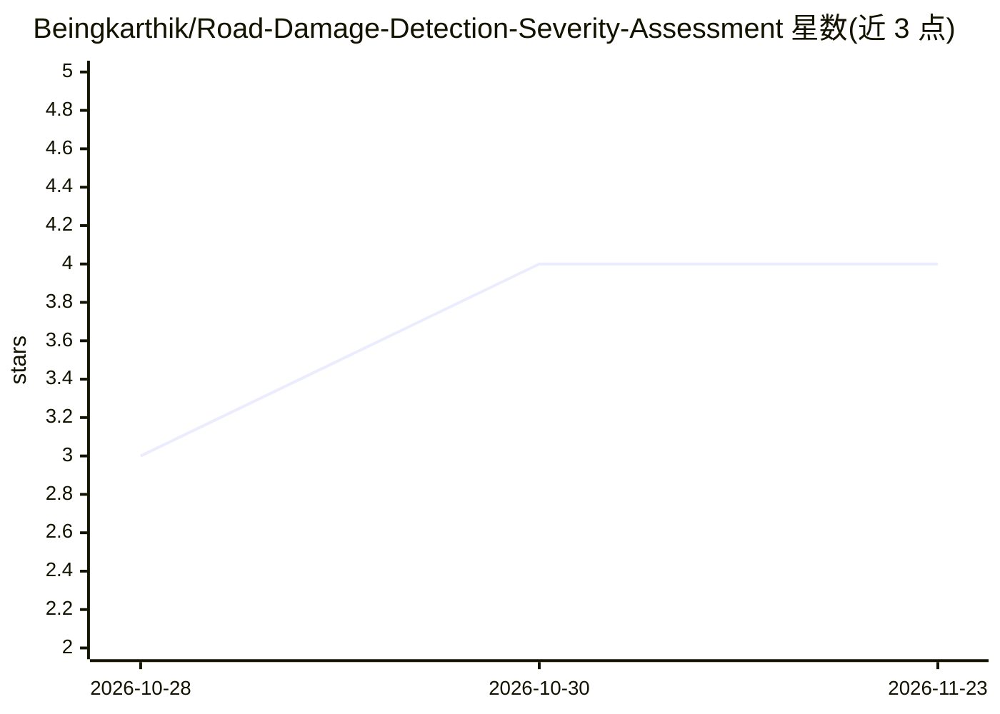

# Beingkarthik/Road-Damage-Detection-Severity-Assessment

⭐ 4 · Python · 推送 2026-10-19 · [GitHub](https://github.com/Beingkarthik/Road-Damage-Detection-Severity-Assessment) · [官网](https://road-damage-detection-severity-assessment-vgzqefg8dabed4bkvx8q.streamlit.app/) · 组织维护

**上传路面图片检测道路损伤并标注位置与置信度的 Web 应用**

RoadLens 是一个基于 YOLO 目标检测模型的道路损伤检测 Web 应用：用户上传道路图片后运行已有训练好的 checkpoint（completed_30_epochs_last.pt）推理，显示边界框、类别标签与置信度，支持调节置信度阈值与推理图像尺寸，并在支持时下载 CSV 报告。技术栈为 Python + Ultralytics + PyTorch + Streamlit + OpenCV，可部署到 Streamlit Community Cloud。模型在 RDD2022 测试集上的 Precision 为 55.27%、Recall 为 51.86%，README 明确说明其输出不构成道路安全认证评估，属原型项目。

## 筛选速览

| 维度 | 判定 | 备注 |
|---|---|---|
| AI 角色 | `ai-native` | 本体是模型或模型工具 |
| 许可风险 | `none` | — |
| 部署形态 | `library` | 以包/库形式分发 |
| 模型依赖 | — | README 未给出锁定关系 |
| 硬件要求 | — | 无带数字的原话,不猜 |
| 安装摩擦 | `low` | 无编译、无系统依赖或容器化 |
| 成熟度 | — | 结构信号不足 |

## 能力要点

- 上传道路图片运行 YOLO 推理，输出边界框、类别与置信度
- 可调节置信度阈值与推理图像尺寸，支持 CSV 报告下载
- 基于 RDD2022 测试集（5,758 张图）提供量化评估指标与混淆矩阵等结果
- 已在 Hugging Face Spaces 与 Streamlit Community Cloud 部署在线版本

## 适用场景

- 对拍摄的道路图片自动识别裂缝等损伤位置
- 辅助道路巡检人员初步筛查可疑路面损伤
- 作为目标检测模型部署与推理的教学演示项目

## 场景标签

`目标检测` · 领域:感知与多模态

## 证据(README 行号)

> L3: An AI-powered computer vision application for detecting road-surface damage from images using a trained YOLO object-
> L34: The application uses a trained YOLO model to identify configured road-damage classes and display predicted location

## 星数曲线

2026-10-28 3 → 2026-11-23 4（+1）

---
*卡片 v1 · prompt 1.4 · 生成 2026-11-21 · 置信度 high · 依据 README sha `90eca650f966` · [字段定义](../../DATASET.md)*
