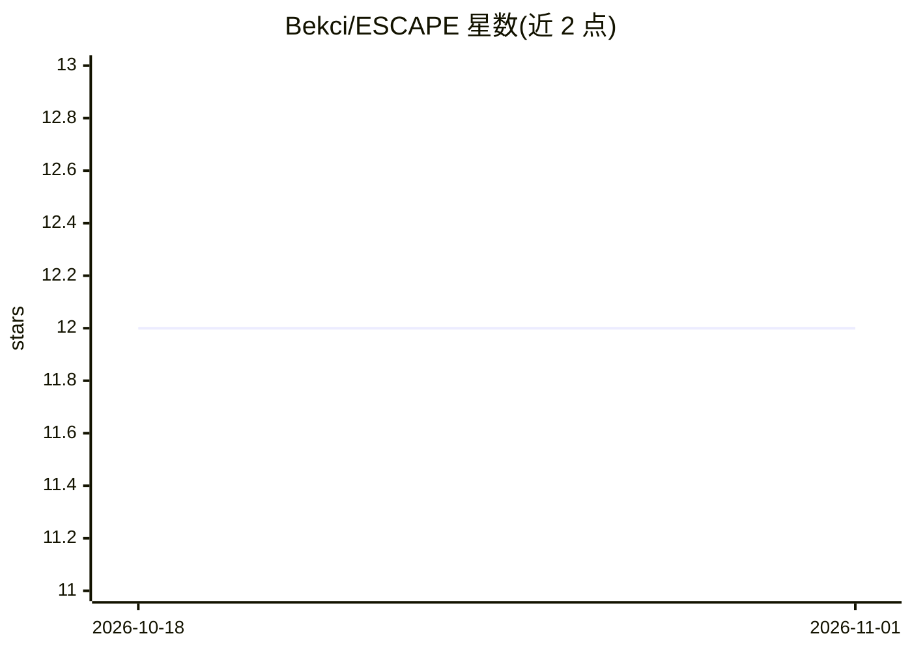

# Bekci/ESCAPE

⭐ 12 · Python · 推送 2025-11-19 · [GitHub](https://github.com/Bekci/ESCAPE) · 个人维护

**旋转等变点云补全框架（CVPR 2025 论文实现）**

CVPR 2025 论文 ESCAPE 的官方实现：通过从形状中选取锚点、将所有点表示为到各锚点的距离，结合 transformer 编解码距离变换，实现旋转等变的三维点云补全；再经优化步骤从编码计算预测形状。无需额外位姿估计模块即可在任意旋转/平移下输出补全结果。面向科研用户，提供训练/评估脚本、PCN/KITTI/OmniObject3D 数据集接入与 PCN 预训练模型。测试环境为 CUDA 11.3、Python 3.8、PyTorch 1.11。

## 筛选速览

| 维度 | 判定 | 备注 |
|---|---|---|
| AI 角色 | `ai-native` | 本体是模型或模型工具 |
| 许可风险 | `none` | — |
| 部署形态 | `None` |  |
| 模型依赖 | — | README 未给出锁定关系 |
| 硬件要求 | — | 无带数字的原话,不猜 |
| 安装摩擦 | `medium` | 含编译或系统依赖之一 |
| 成熟度 | — | 结构信号不足 |

## 能力要点

- 锚点距离编码实现旋转等变点云补全
- transformer 编解码距离变换并经优化生成预测形状
- 支持 PCN/KITTI/OmniObject3D 数据集训练与评估
- 提供 PCN 预训练模型与推理 Notebook

## 适用场景

- 在任意旋转/平移条件下补全部分点云
- 复现或扩展旋转等变形状补全实验
- 用预训练模型在 PCN 数据上做点云补全推理

## 场景标签

`科研工具` · 领域:学习与行业

## 证据(README 行号)

> L3: Implementation of the paper ESCAPE: Equivariant Shape Completion via Anchor Point Encoding.
> L9: ESCAPE (Equivariant Shape Completion via Anchor Point Encoding), a novel framework designed
> L13: Subsequently, we perform optimization to calculate the predicted shapes from the encodings. Experimental evaluation

## 星数曲线

2026-10-18 12 → 2026-11-01 12（+0）

---
*卡片 v1 · prompt 1.4 · 生成 2026-11-01 · 置信度 high · 依据 README sha `2b3edd28559c` · [字段定义](../../DATASET.md)*
