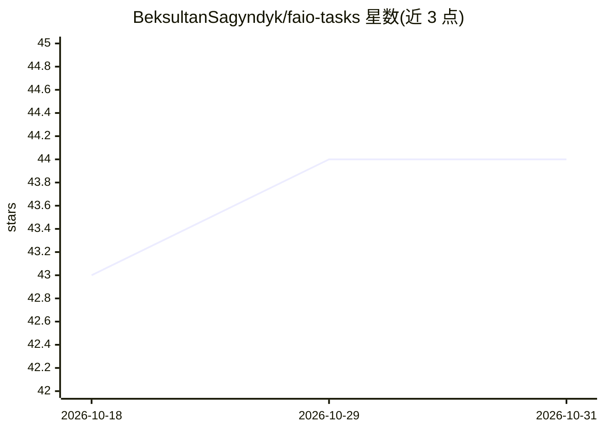

# BeksultanSagyndyk/faio-tasks

⭐ 44 · Jupyter Notebook · Apache-2.0 · 推送 2025-11-12 · [GitHub](https://github.com/BeksultanSagyndyk/faio-tasks) · [官网](https://faio.kz/) · 组织维护

**Fizmat AI 奥林匹克竞赛题目、解法与起步包归档库**

收录 2024 年至今哈萨克斯坦 Fizmat AI Olympiad（FAIO）的竞赛题目、解答与 starter kit，按年份和轮次/赛道组织：faio-2024 含资格轮与 day-1，faio-2025 含资格轮与 day-1、day-2。仓库声明用途为学习、练习与归档。使用方式为 git clone 后浏览目录，无其他安装或运行步骤。由多名组织者/评委/作者共同维护，附竞赛官网链接。

## 筛选速览

| 维度 | 判定 | 备注 |
|---|---|---|
| AI 角色 | `ai-knowledge` | 知识聚合/清单类 |
| 许可风险 | `permissive` | Apache-2.0 |
| 部署形态 | `None` |  |
| 模型依赖 | — | README 未给出锁定关系 |
| 硬件要求 | — | 无带数字的原话,不猜 |
| 安装摩擦 | `low` | 无编译、无系统依赖或容器化 |
| 成熟度 | — | 结构信号不足 |

## 能力要点

- 按年份与轮次组织的 FAIO 竞赛任务集（2024–2025）
- 包含任务、解答与 starter kit
- 提供 git clone 获取方式的 Quick Start

## 适用场景

- 备赛 AI 奥林匹克竞赛时练习历年真题
- 查找 FAIO 资格轮与正赛各日的题目和解法
- 作为竞赛材料的归档参考

## 场景标签

`教程课程` · 领域:学习与行业

## 证据(README 行号)

> L6:  🎓 Fizmat AI Olympiad — tasks, solutions & starter kits.
> L11: This repository collects tasks by year and (where applicable) by day/track.

## 星数曲线

2026-10-18 43 → 2026-10-31 44（+1）

---
*卡片 v1 · prompt 1.4 · 生成 2026-10-25 · 置信度 high · 依据 README sha `864d2a7f1107` · [字段定义](../../DATASET.md)*
