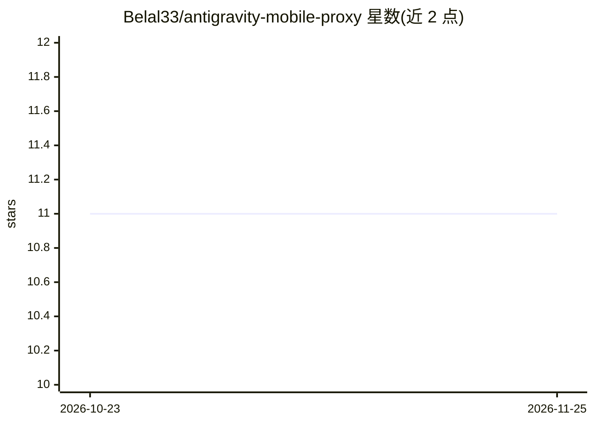

# Belal33/antigravity-mobile-proxy

⭐ 11 · TypeScript · MIT · 推送 2026-04-11 · [GitHub](https://github.com/Belal33/antigravity-mobile-proxy) · 个人维护

**从手机/平板浏览器远程操控 Antigravity AI 编码代理**

一个 Node.js/Next.js 代理服务，通过 Chrome DevTools Protocol (CDP) 连接本机 Antigravity IDE 的代理面板，把消息写入 IDE 并每 500ms 读取面板状态，再经 SSE 流式回传到浏览器聊天界面。用户可在任意设备的浏览器上向 AI 编码代理发消息、查看工具执行与文件改动、批准/拒绝需权限的操作、浏览产物和管理会话。经 ngrok 建立加密隧道并用 Google OAuth 限定访问邮箱；支持本地无隧道模式、多窗口切换、systemd/launchd/任务计划常驻服务，并提供版本化 REST API。

## 筛选速览

| 维度 | 判定 | 备注 |
|---|---|---|
| AI 角色 | `ai-ecosystem` | LLM/agent 周边工具 |
| 许可风险 | `permissive` | MIT |
| 部署形态 | `library` | 以包/库形式分发 |
| 模型依赖 | — | README 未给出锁定关系 |
| 硬件要求 | — | 无带数字的原话,不猜 |
| 安装摩擦 | `low` | 无编译、无系统依赖或容器化 |
| 成熟度 | — | 结构信号不足 |

## 能力要点

- 通过 CDP 驱动 Antigravity IDE，浏览器端实时查看命令输出/文件编辑/MCP 工具调用
- 远程批准/拒绝（HITL）操作与会话管理，支持多 IDE 窗口切换
- ngrok 隧道 + Google OAuth 邮箱白名单限制访问
- 提供 /api/v1/ 版本化 REST API 与 SSE 事件流

## 适用场景

- 离开电脑时用手机查看和指挥 IDE 里的编码代理
- 远程批准代理执行命令或改文件的权限请求
- 在局域网外通过安全隧道访问本机开发环境

## 场景标签

`编码 Agent` · 领域:编码与开发

## 证据(README 行号)

> L18: Antigravity is an AI coding agent that lives inside your IDE. Normally, you can only interact with it from the IDE 
> L268: 3. **The proxy types it into the IDE** using Chrome DevTools Protocol (CDP)
> L270: 5. **Changes are streamed back** to your browser in real-time via Server-Sent Events (SSE)

## 星数曲线

2026-10-23 11 → 2026-11-25 11（+0）

---
*卡片 v1 · prompt 1.4 · 生成 2026-11-19 · 置信度 high · 依据 README sha `3223fe3c94d3` · [字段定义](../../DATASET.md)*
