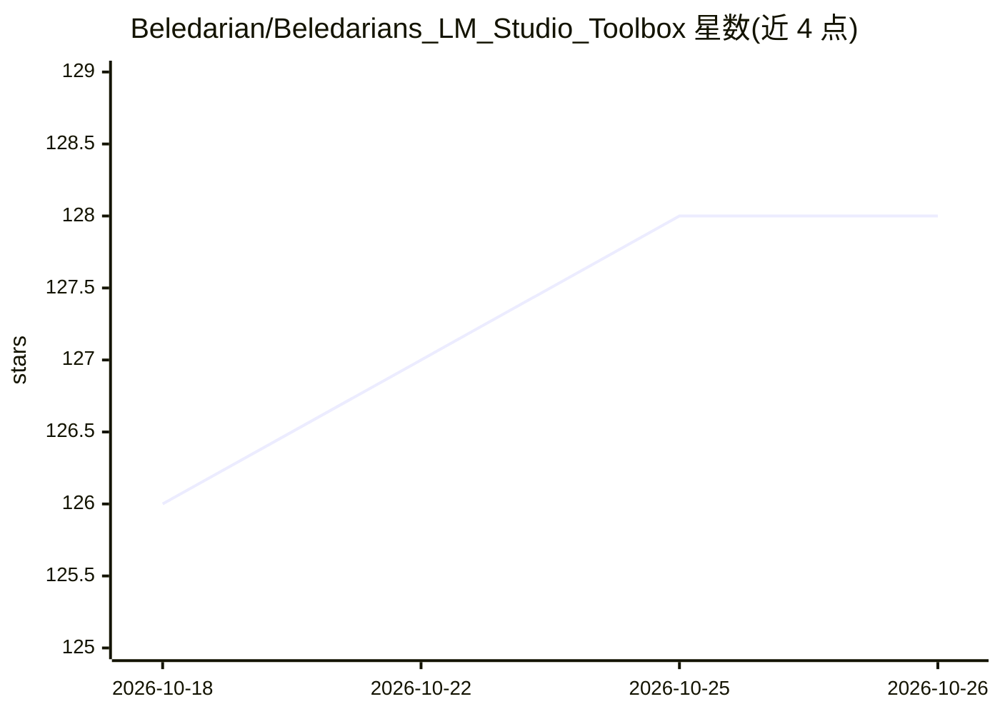

# Beledarian/Beledarians_LM_Studio_Toolbox

⭐ 128 · TypeScript · MIT · 推送 2026-09-14 · [GitHub](https://github.com/Beledarian/Beledarians_LM_Studio_Toolbox) · 个人维护 · 中文 README

**LM Studio 插件：为本地 LLM 提供文件、代码执行与上网等工具集**

面向 LM Studio（v0.3.0+）的插件，在 LLM 与本地环境之间充当桥梁：提供工作区沙箱内的文件增删改查、Deno/JavaScript 与 Python 代码执行、shell/终端命令、DuckDuckGo/Wikipedia 搜索、Puppeteer 浏览器自动化、Web/本地 RAG 等工具。支持委派二级代理（sub-agent）执行编码、审查与自动保存代码，包含原生 Git 与 GitHub CLI 工具链。要求 Node.js v18+，通过 LM Studio 插件页安装或源码开发模式运行。

## 筛选速览

| 维度 | 判定 | 备注 |
|---|---|---|
| AI 角色 | `ai-ecosystem` | LLM/agent 周边工具 |
| 许可风险 | `permissive` | MIT |
| 部署形态 | `library` | 以包/库形式分发 |
| 模型依赖 | — | README 未给出锁定关系 |
| 硬件要求 | — | 无带数字的原话,不猜 |
| 安装摩擦 | `low` | 无编译、无系统依赖或容器化 |
| 成熟度 | — | 结构信号不足 |

## 能力要点

- 工作区沙箱内的全套文件系统操作工具（含批量与精确替换）
- Deno/Python 代码执行与 shell/终端命令
- DuckDuckGo/Wikipedia 搜索、Puppeteer 持久浏览器会话与 Web/本地 RAG
- 二级代理委派、自动保存代码与可选自动调试审查

## 适用场景

- 在 LM Studio 中让本地模型自主完成编码与项目脚手架任务
- 让 LLM 在工作区内管理文件并执行生成的代码
- 为模型接入网页搜索、浏览器自动化与本地代码语义检索

## 场景标签

`浏览器自动化` `RAG` `编码 Agent` · 领域:效率与自动化

## 证据(README 行号)

> L9: This project is a plugin for LM Studio that provides a rich set of tools to a large language model. It acts as a bri
> L103: - Node.js (v18+)
> L104: - LM Studio (v0.3.0+)

## 星数曲线

2026-10-18 126 → 2026-10-26 128（+2）

---
*卡片 v1 · prompt 1.4 · 生成 2026-10-23 · 置信度 mid · 依据 README sha `e8a17e5e7e77` · [字段定义](../../DATASET.md)*
