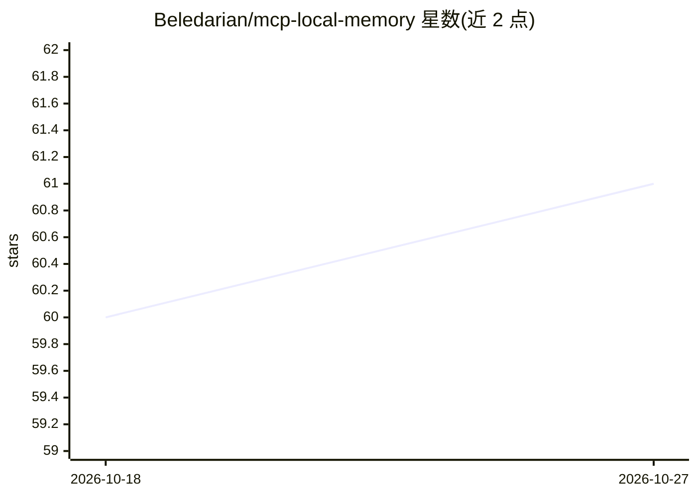

# Beledarian/mcp-local-memory

⭐ 61 · TypeScript · MIT · 推送 2026-09-14 · [GitHub](https://github.com/Beledarian/mcp-local-memory) · 个人维护

**本地优先的 MCP 记忆服务器：为 AI agent 提供共享持久记忆**

面向 AI agent 的本地记忆 MCP 服务器：以单一 SQLite 数据库为 Codex、Claude、桌面客户端、IDE 集成等多种 MCP 客户端提供共享记忆，数据默认保存在本地 SQLite 文件，无需 Docker 或云服务。检索机制为混合式：语义向量（本地 all-MiniLM-L6-v2 嵌入 + sqlite-vec）与 FTS5 关键词独立检索后合并，FTS 为显式回退；排序综合相关性、时间衰减重要性、标签与有界的熟悉度信号。支持实体/关系知识图谱、自然语言时间检索、记忆生命周期（强化/标记过期/恢复/遗忘）。可选 LLM 功能通过配置的 OLLAMA_URL 端点实现实体关系抽取。支持 stdio 与 SSE 两种传输模式，后者可用于 Docker Compose 部署。限制：升级迁移不保证零丢失，需自行备份。

## 筛选速览

| 维度 | 判定 | 备注 |
|---|---|---|
| AI 角色 | `ai-ecosystem` | LLM/agent 周边工具 |
| 许可风险 | `permissive` | MIT |
| 部署形态 | `self-host` | docker 或自建部署 |
| 模型依赖 | local-ok | 支持本地模型 |
| 硬件要求 | — | 无带数字的原话,不猜 |
| 安装摩擦 | `low` | 无编译、无系统依赖或容器化 |
| 成熟度 | — | 结构信号不足 |

## 能力要点

- 单一 SQLite 数据库跨多个 MCP 客户端共享记忆
- 语义向量与 FTS5 关键词混合检索，FTS 为显式回退
- 实体/关系/观察的知识图谱与一到两跳图探索、聚类
- 记忆生命周期管理：强化、标记过期/错误、恢复、遗忘

## 适用场景

- 让多个 coding agent 共享对代码库和用户偏好的持久记忆
- 团队在多台工作站通过 SSE 模式集中部署记忆服务
- 用知识图谱记录项目、人物等命名概念间的关系
- 按自然语言时间（如 last week）检索历史记忆

## 场景标签

`Agent 记忆` `知识图谱` · 领域:Agent 开发

## 证据(README 行号)

> L3: A local-first MCP server that gives AI agents shared, durable memory through
> L11: - **Shared across agents:** one SQLite database can serve Codex, Claude,
> L105: |`OLLAMA_URL`|`http://localhost:11434/api/generate`|Optional LLM generation endpoint.|

## 星数曲线

2026-10-18 60 → 2026-10-27 61（+1）

---
*卡片 v1 · prompt 1.4 · 生成 2026-10-24 · 置信度 high · 依据 README sha `d34e0408faba` · [字段定义](../../DATASET.md)*
