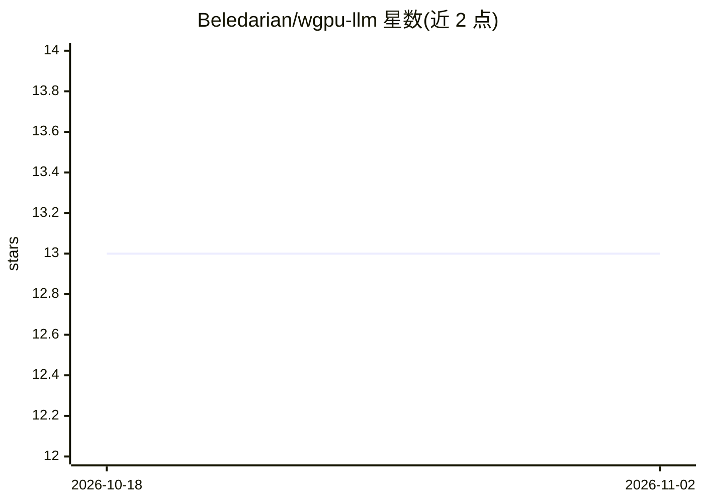

# Beledarian/wgpu-llm

⭐ 13 · Rust · Apache-2.0 · 推送 2026-08-30 · [GitHub](https://github.com/Beledarian/wgpu-llm) · 个人维护

**Rust+WGSL 编写的跨平台本地 LLM 推理引擎，无需 CUDA**

从零实现的 Llama 系列推理引擎：用 wgpu v29 调度 12 个 WGSL 计算着色器完成 Transformer 全前向过程，以 Rust 为宿主语言，不依赖 PyTorch 等框架，可在任何具备 Vulkan/Metal/DX12 驱动的 GPU 上运行（含 Snapdragon Adreno 集成显卡）。支持 f16 权重与 INT8 块量化（约省一半显存）、分页 KV 缓存、GQA。当前限制：仅解码式逐 token 处理 prompt、单序列无批处理、无聊天模板、自述为 Alpha 质量。

## 筛选速览

| 维度 | 判定 | 备注 |
|---|---|---|
| AI 角色 | `ai-ecosystem` | LLM/agent 周边工具 |
| 许可风险 | `permissive` | Apache-2.0 |
| 部署形态 | `library` | 以包/库形式分发 |
| 模型依赖 | — | README 未给出锁定关系 |
| 硬件要求 | — | 无带数字的原话,不猜 |
| 安装摩擦 | `high` | 编译与系统依赖俱全 |
| 成熟度 | `idea` | |

## 能力要点

- 12 个 WGSL 计算着色器覆盖 GEMM/RMSNorm/RoPE 等全部算子
- 跨 Vulkan/Metal/DX12 后端，无需 CUDA，支持 Adreno 移动 GPU
- INT8 块量化约 2 倍显存缩减，附量化脚本
- 支持 TinyLlama、Llama 2/3 及兼容微调模型（GQA）

## 适用场景

- 在无 CUDA 支持（如 Snapdragon Copilot+ 笔记本）的 GPU 上跑本地 Llama 模型
- 学习 Transformer 推理的着色器级实现（每层为独立 WGSL shader）
- 对 Llama 系小模型做本地文本补全实验

## 场景标签

`推理引擎` · 领域:训练与推理

## 证据(README 行号)

> L3: > A minimalist Llama inference engine written in Rust and WGSL.
> L10: A from-scratch LLM inference engine that uses wgpu v29 to dispatch WGSL compute shaders for the full Transformer fo

## 星数曲线

2026-10-18 13 → 2026-11-02 13（+0）

---
*卡片 v1 · prompt 1.4 · 生成 2026-10-31 · 置信度 high · 依据 README sha `438a99b59914` · [字段定义](../../DATASET.md)*
