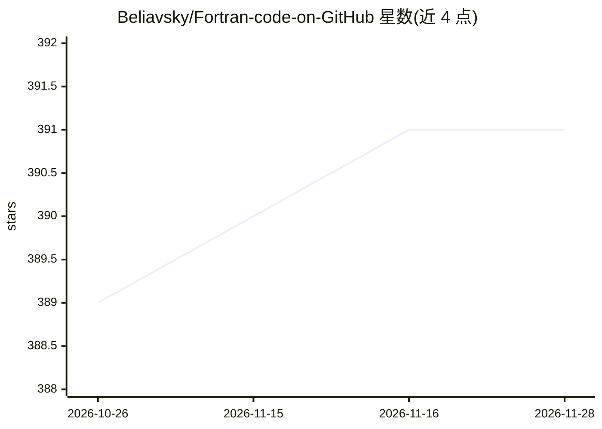

# Beliavsky/Fortran-code-on-GitHub

⭐ 391 · Unlicense · 推送 2026-11-27 · [GitHub](https://github.com/Beliavsky/Fortran-code-on-GitHub) · [官网](https://beliavsky.github.io/Fortran-code-on-GitHub/) · 个人维护

**按主题分类的 GitHub 开源 Fortran 代码目录清单**

以清单形式收录 GitHub 上的 Fortran 代码仓库，按艺术与音乐、天文与天体物理等主题分类排列，每条目含项目名、作者与功能简介，部分条目附关联论文信息。维护者邀请用户提交修改建议，并指向 fortran-lang 包索引作为补充资源。目录本身不提供安装或运行方式，仅作为检索入口。

## 筛选速览

| 维度 | 判定 | 备注 |
|---|---|---|
| AI 角色 | `ai-knowledge` | 知识聚合/清单类 |
| 许可风险 | `permissive` | Unlicense |
| 部署形态 | `None` |  |
| 模型依赖 | — | README 未给出锁定关系 |
| 硬件要求 | — | 无带数字的原话,不猜 |
| 安装摩擦 | `medium` | 含编译或系统依赖之一 |
| 成熟度 | — | 结构信号不足 |

## 能力要点

- 按主题分类组织的 GitHub Fortran 代码目录
- 每条目包含项目名、作者与功能说明
- 部分条目附关联论文出处
- 指向 fortran-lang 包索引作为补充

## 适用场景

- 查找某个科学计算领域的现成 Fortran 代码
- 为课题调研可复用的数值计算实现
- 了解 Fortran 在各学科的应用项目分布

## 场景标签

`精选清单` · 领域:学习与行业

## 证据(README 行号)

> L1: ### Also see fortran-lang package index. Please suggest changes here.
> L4: ## Art and Music
> L25: ## Astronomy and Astrophysics

## 星数曲线

2026-10-26 389 → 2026-11-28 391（+2）

---
*卡片 v1 · prompt 1.4 · 生成 2026-11-25 · 置信度 high · 依据 README sha `3b16b9ff3485` · [字段定义](../../DATASET.md)*
