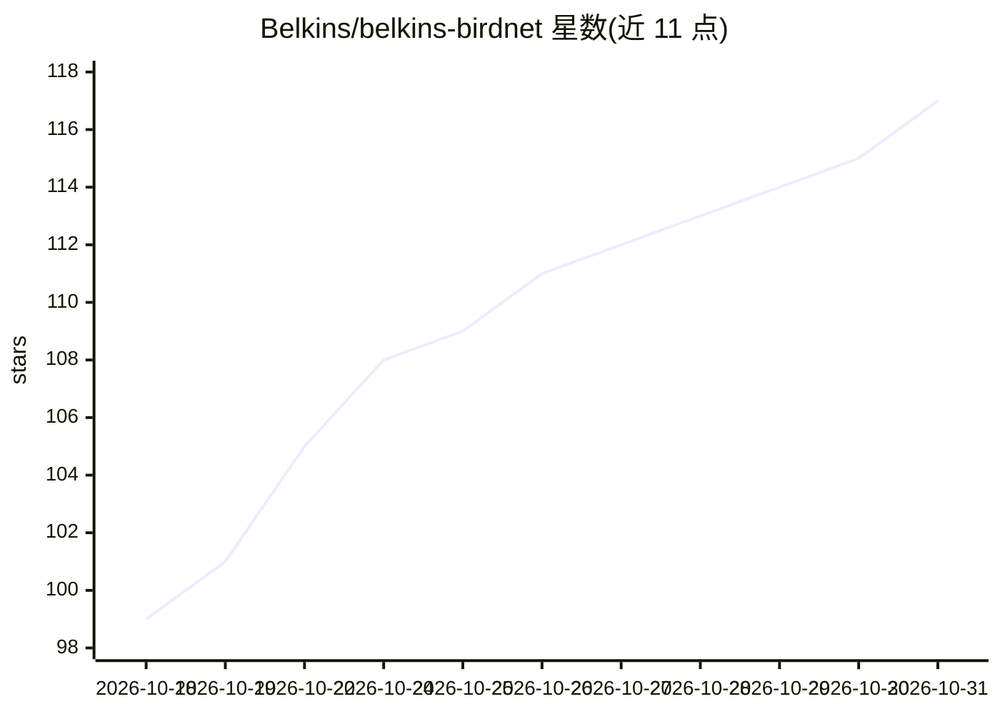

# Belkins/belkins-birdnet

⭐ 117 · Python · NOASSERTION · 推送 2026-09-09 · [GitHub](https://github.com/Belkins/belkins-birdnet) · 组织维护

**树莓派鸟类鸣声识别装置：实时鸟鸣检测生成手绘鸟图拼贴**

基于 BirdNET-Pi 的独立构建：USB 麦克风采集窗外鸟鸣，Cornell BirdNET 6K v2.4 模型识别 6,522 类标签，检测到 3 秒内将物种以手绘 kachō-e 插画形式呈现到网页拼贴墙，含 250 物种 500 幅内置插画。通过一键脚本安装到 Raspberry Pi，以 SQLite 存储检测数据；未收录物种可经部署在 Railway 的 FastAPI 服务调用 Gemini 现场生成插画。可选 13.3 英寸 e-ink 相框、Cloudflare Tunnel 转发、MQTT/Home Assistant 集成。许可 CC-BY-NC-SA-4.0，仅限非商业使用。

## 筛选速览

| 维度 | 判定 | 备注 |
|---|---|---|
| AI 角色 | `ai-native` | 本体是模型或模型工具 |
| 许可风险 | `none` | NOASSERTION |
| 部署形态 | `library` | 以包/库形式分发 |
| 模型依赖 | — | README 未给出锁定关系 |
| 硬件要求 | — | 无带数字的原话,不猜 |
| 安装摩擦 | `low` | 无编译、无系统依赖或容器化 |
| 成熟度 | — | 结构信号不足 |

## 能力要点

- BirdNET 6K v2.4 模型实时鸟鸣识别，检测到上屏 3 秒内
- 250 物种 500 幅内置手绘插画，未收录物种由 Gemini 管线按需生成
- SSE 实时推送 + Vite/React 拼贴前端，只读 SQLite 存储
- 三种局域网外转发方案（Cloudflare Tunnel / Home Assistant / MQTT）

## 适用场景

- 窗外麦克风实时识别鸟鸣并在屏幕拼贴墙展示
- 博物风格观赏家中到访鸟类并查看统计与图鉴
- 把近 24 小时检测结果镜像到 e-ink 壁挂相框

## 场景标签

`图像生成` · 领域:内容生成

## 证据(README 行号)

> L20: A single $17 USB microphone in your window turns the birds outside into a **living collage**. Belkins BirdNET liste
> L9:  Model: BirdNET 6K v2.4

## 星数曲线

2026-10-18 99 → 2026-10-31 117（+18）

---
*卡片 v1 · prompt 1.4 · 生成 2026-10-23 · 置信度 mid · 依据 README sha `27e95678a9c9` · [字段定义](../../DATASET.md)*
