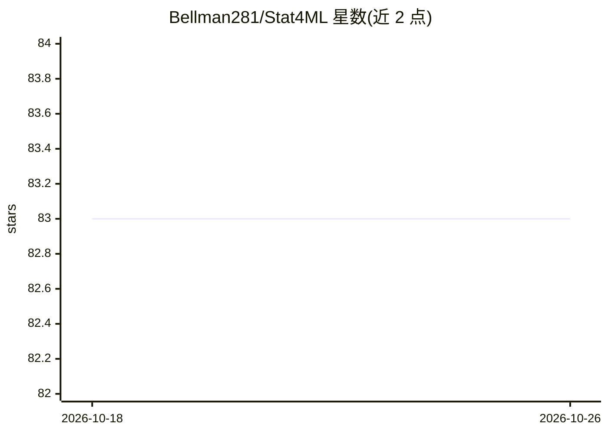

# Bellman281/Stat4ML

⭐ 83 · Python · NOASSERTION · 推送 2026-10-14 · [GitHub](https://github.com/Bellman281/Stat4ML) · 个人维护

**机器学习数学与统计的自学课程：证明加代码练习**

免费、自进度的统计与数学课程，面向机器学习、深度学习与强化学习背后的数学基础。每个概念以定义、定理与完整证明写成章节（PDF 附 LaTeX 源码），并配 Python/R 三种形式的练习（从零实现的 TODO、故意植入缺陷需调试的副本、参考答案）。rustlings 风格的 drill.py 逐题驱动：运行、读失败检查、修复、通过。Python 练习仅用标准库，R 练习仅用 base R，无需额外安装。课程分三部分共 26 章，按 bachelor/master/phd 分级，标注为 GPLv2 许可，作者为个人讲师。

## 筛选速览

| 维度 | 判定 | 备注 |
|---|---|---|
| AI 角色 | `ai-knowledge` | 知识聚合/清单类 |
| 许可风险 | `none` | NOASSERTION |
| 部署形态 | `None` |  |
| 模型依赖 | — | README 未给出锁定关系 |
| 硬件要求 | — | 无带数字的原话,不猜 |
| 安装摩擦 | `low` | 无编译、无系统依赖或容器化 |
| 成熟度 | — | 结构信号不足 |

## 能力要点

- 三部分 26 章：统计基础、统计学习、深度学习/强化学习的统计基础
- 每章配定义/定理/证明与 Python/R 各三份练习（TODO、缺陷调试、参考答案）
- drill.py 逐题训练，按 bachelor/master/phd 三级筛选练习
- Python 练习仅依赖标准库，R 练习仅 base R

## 适用场景

- 系统补齐 ML/DL 背后的概率统计与证明基础
- 通过修复故意破坏的代码加深对定理的理解
- 按本科/硕士/博士层级自选练习难度

## 场景标签

`教程课程` · 领域:学习与行业

## 证据(README 行号)

> L5: A free, self-paced course in the mathematics that modern machine learning actually
> L29: - **The chapter, written out properly.** Not slide bullets — prose with real

## 星数曲线

2026-10-18 83 → 2026-10-26 83（+0）

---
*卡片 v1 · prompt 1.4 · 生成 2026-10-24 · 置信度 high · 依据 README sha `0b8374bddd12` · [字段定义](../../DATASET.md)*
