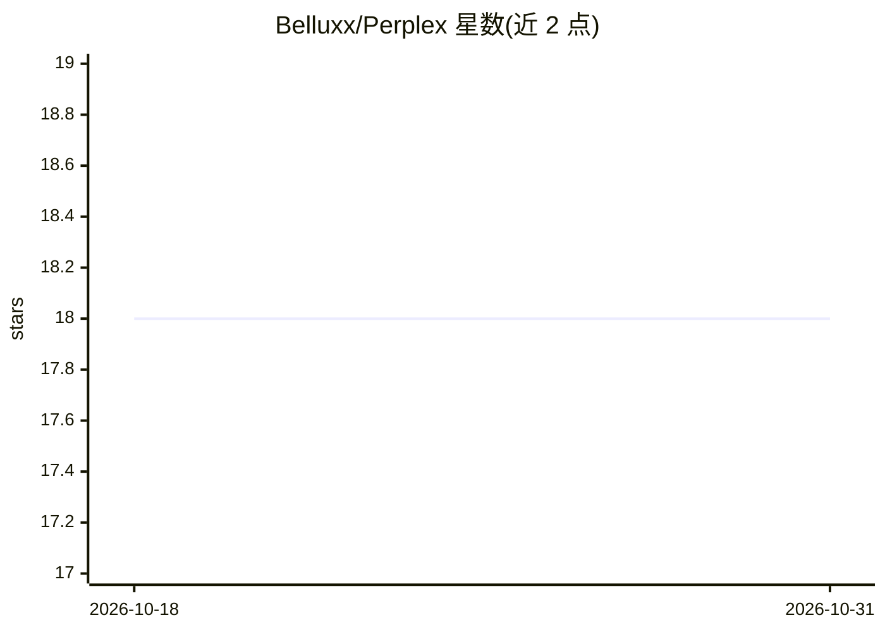

# Belluxx/Perplex

⭐ 18 · Rust · 推送 2026-08-03 · [GitHub](https://github.com/Belluxx/Perplex) · 个人维护

**离线查看 LLM 对文本的 logprobs 与困惑度的桌面工具**

基于 llama.cpp 的离线分析工具：加载本地 GGUF 模型文件，对用户输入的文本做逐 token 的概率分析，按预测好坏以绿/红颜色标注 token，悬停可查看该 token 在模型预测中的排名及 top-5 最高概率 token 榜单，并支持类似 git diff 的两模型对比。以 Rust 编写，通过 cargo 构建运行，需自备 GGUF 模型文件。可用于探测文本对模型的“惊讶程度”（如辅助判断 AI 生成文本）或理解 LLM 内部机制。

## 筛选速览

| 维度 | 判定 | 备注 |
|---|---|---|
| AI 角色 | `ai-native` | 本体是模型或模型工具 |
| 许可风险 | `none` | — |
| 部署形态 | `None` |  |
| 模型依赖 | local-ok | 支持本地模型 |
| 硬件要求 | — | 无带数字的原话,不猜 |
| 安装摩擦 | `low` | 无编译、无系统依赖或容器化 |
| 成熟度 | — | 结构信号不足 |

## 能力要点

- 加载本地 GGUF 模型，离线分析文本，无需联网
- 逐 token 标注预测好坏（绿/红），悬停显示排名与 top-5 候选 token
- 支持两个 LLM 的 diff 式对比

## 适用场景

- 查看一段文本对某个本地模型的困惑度分布
- 对比两个 GGUF 模型对同一文本的预测差异
- 教学或学习场景下直观理解 LLM 的 token 预测机制

## 场景标签

 · 领域:LLM 分析工具

## 证据(README 行号)

> L3: This offline tool allows you to analyze a given text and see how "surprising" it is to a LLM. It may be useful to se
> L5: This is based on the awesome work by the llama.cpp team, so you will need to specify yout `.gguf` file to use it.

## 星数曲线

2026-10-18 18 → 2026-10-31 18（+0）

---
*卡片 v1 · prompt 1.4 · 生成 2026-10-29 · 置信度 high · 依据 README sha `18ecd62655d5` · [字段定义](../../DATASET.md)*
