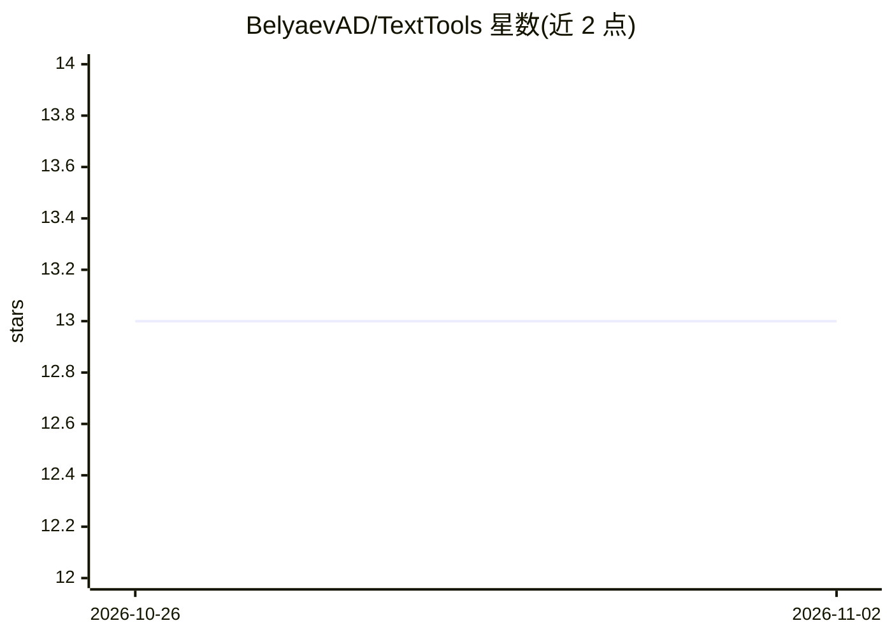

# BelyaevAD/TextTools

⭐ 13 · AutoHotkey · MIT · 推送 2026-10-24 · [GitHub](https://github.com/BelyaevAD/TextTools) · [官网](https://belyaevad.github.io/TextTools/) · 个人维护

**Windows 选中文本的 LLM 处理热键工具（校对/改写/压缩等）**

AutoHotkey v2 编写的 Windows 桌面脚本：在任意窗口选中文本后按热键，从动作菜单选择通过 LLM 执行校对、改写、压缩、生成表格、分析代码等操作，结果可替换选中文本或在独立窗口打开。支持任意 OpenAI 兼容端点（OpenRouter、OpenAI、Anthropic 代理、本地 Ollama 等），HTTP 请求经系统 curl.exe 发出，支持可选 HTTP/HTTPS/SOCKS 代理。内置动作与提示词编辑器、每动作独立模型与回复语言设置、最近 20 次历史、token 精确计数与基于 OpenRouter 目录的成本估算。需 Windows 10/11、AutoHotkey v2、系统 curl.exe 与 API key，通过 git clone 加 install.ps1 安装。

## 筛选速览

| 维度 | 判定 | 备注 |
|---|---|---|
| AI 角色 | `ai-native` | 本体是模型或模型工具 |
| 许可风险 | `permissive` | MIT |
| 部署形态 | `desktop` | 安装包/桌面程序 |
| 模型依赖 | local-ok | 支持本地模型 |
| 硬件要求 | — | 无带数字的原话,不猜 |
| 安装摩擦 | `low` | 无编译、无系统依赖或容器化 |
| 成熟度 | — | 结构信号不足 |

## 能力要点

- 任意 OpenAI 兼容端点，含本地 Ollama 与代理支持
- 动作/提示词编辑器与每动作独立模型、18 种回复语言
- token 精确计数与基于 OpenRouter 目录的成本估算
- API key 仅本地存储，历史可从托盘清除

## 适用场景

- 写作时选中文本快速校对、改写或压缩
- 不切换窗口地对代码片段做 LLM 分析
- 配合本地 Ollama 做离线风格的文本处理

## 场景标签

`AI 写作` `AI 助手` · 领域:对话与助手

## 证据(README 行号)

> L9: Небольшой скрипт на AutoHotkey v2. Выделяешь текст в любом окне Windows, жмёшь хоткей и выбираешь, что сделать через
> L38: - Любой OpenAI-совместимый endpoint (OpenRouter, OpenAI, прокси Anthropic, локальный Ollama…)

## 星数曲线

2026-10-26 13 → 2026-11-02 13（+0）

---
*卡片 v1 · prompt 1.4 · 生成 2026-10-31 · 置信度 high · 依据 README sha `2a0b70e692ef` · [字段定义](../../DATASET.md)*
