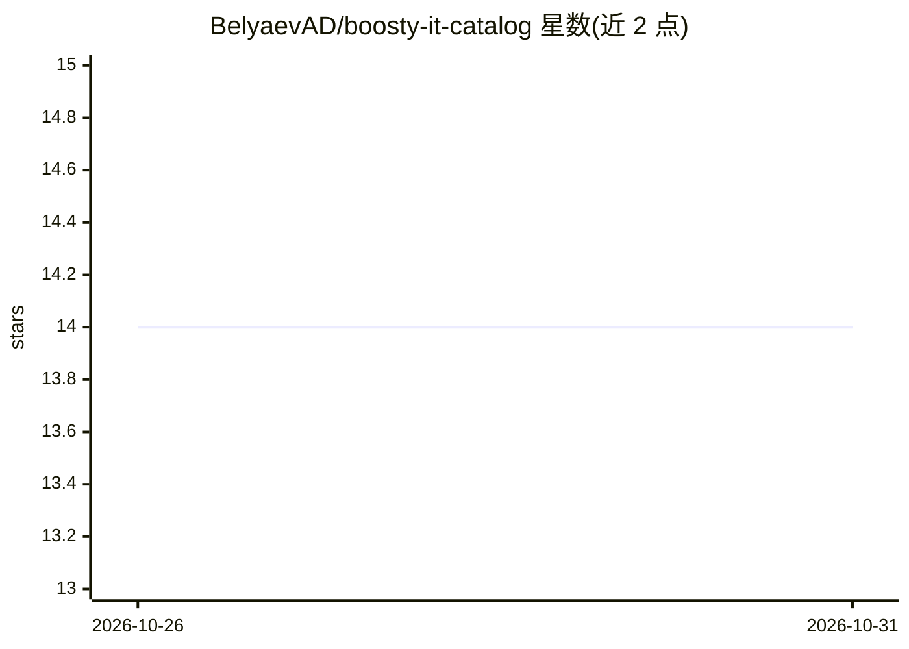

# BelyaevAD/boosty-it-catalog

⭐ 14 · JavaScript · MIT · 推送 2026-10-30 · [GitHub](https://github.com/BelyaevAD/boosty-it-catalog) · [官网](https://belyaevad.github.io/boosty-it-catalog/) · 个人维护

**俄语 IT 付费频道开放目录：发现与比较 Boosty 上的订阅制频道**

收录 Boosty 平台上俄语 IT 频道的开放目录与静态网站：覆盖 AI、编程、架构、DevOps、self-hosting、安全、数据、QA、gamedev、1С 等主题。网站提供表格与卡片两种视图，支持按主题、活跃度、价格、订阅者数筛选排序，可查看频道详情与订阅层级并跳转 Boosty。数据每周五自动更新，仅使用公开页面信息并清洗联系方式，经 issue 模板人工审核后收录。项目声明与 Boosty 无关联、不评价内容质量。

## 筛选速览

| 维度 | 判定 | 备注 |
|---|---|---|
| AI 角色 | `ai-knowledge` | 知识聚合/清单类 |
| 许可风险 | `permissive` | MIT |
| 部署形态 | `None` |  |
| 模型依赖 | — | README 未给出锁定关系 |
| 硬件要求 | — | 无带数字的原话,不猜 |
| 安装摩擦 | `low` | 无编译、无系统依赖或容器化 |
| 成熟度 | — | 结构信号不足 |

## 能力要点

- 表格/卡片双视图，按主题、活跃度、价格、订阅者数筛选排序
- 每周五（莫斯科时间）自动更新，仅使用公开页面数据
- data/channels.json 与 data/raw/boosty-candidates.json 开放数据文件
- 公开描述清洗 e-mail/电话/支付账号等联系信息

## 适用场景

- 按主题和价格比较 Boosty 上的俄语 IT 频道再决定订阅
- 查找 AI、DevOps、self-hosting 等领域的俄语付费内容作者
- 获取结构化的频道开放数据用于自己的分析

## 场景标签

`精选清单` · 领域:学习与行业

## 证据(README 行号)

> L3: Открытый каталог русскоязычных IT-каналов с платной подпиской на Boosty. Здесь можно найти и сравнить авторов об ИИ,
> L46: - `data/channels.json` — проверенные каналы, опубликованные на сайте;

## 星数曲线

2026-10-26 14 → 2026-10-31 14（+0）

---
*卡片 v1 · prompt 1.4 · 生成 2026-10-31 · 置信度 mid · 依据 README sha `8b809bc2dad2` · [字段定义](../../DATASET.md)*
