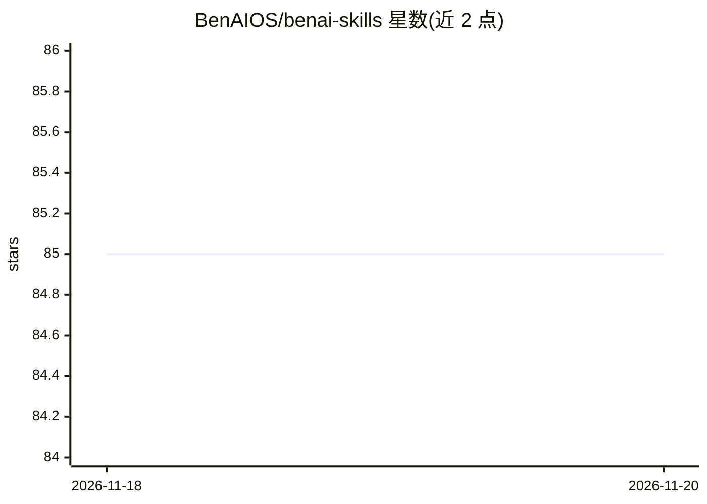

# BenAIOS/benai-skills

⭐ 85 · JavaScript · MIT · 推送 2026-11-17 · [GitHub](https://github.com/BenAIOS/benai-skills) · 个人维护

**面向 Claude Code 的按部门组织的业务自动化技能集**

为 Claude Code 提供插件市场形式安装的技能集合，按 Marketing、Sales、Operations、Creative、YouTube、Marketing OS 等部门组织共 60 余个技能：覆盖 SEO 审计与优化、B2B 线索挖掘外呼流水线、YouTube 五阶段发布链、n8n 工作流自动化、FFmpeg/Remotion 视频剪辑、信息图生成（Gemini）等。部分技能需要 .env 中配置 GEMINI、Apify、n8n、GSC 等 API key，视频剪辑依赖 FFmpeg 与 Remotion，YouTube Studio 操作使用 Claude in Chrome。

## 筛选速览

| 维度 | 判定 | 备注 |
|---|---|---|
| AI 角色 | `ai-ecosystem` | LLM/agent 周边工具 |
| 许可风险 | `permissive` | MIT |
| 部署形态 | `None` |  |
| 模型依赖 | locked-api |  |
| 硬件要求 | — | 无带数字的原话,不猜 |
| 安装摩擦 | `medium` | 含编译或系统依赖之一 |
| 成熟度 | — | 结构信号不足 |

## 能力要点

- 插件市场命令一键安装，按 8 个部门组织 60+ 技能
- B2B 外呼流水线编排 4 个并行子代理（评分/调研/抓取/破冰撰写）
- 五阶段 YouTube 发布链，含 4 个人工检查点
- Marketing OS 构建幂等可重跑的 markdown 第二大脑与仪表盘

## 适用场景

- 在 Claude Code 中执行 SEO 审计、内容再利用与邮件序列
- 搭建销售线索挖掘与个性化外呼流水线
- 自动化 YouTube 视频的发布准备与内容再加工

## 场景标签

`工作流自动化` · 领域:效率与自动化

## 证据(README 行号)

> L3: Expert automation skills for Claude Code, organized by department.
> L8: # Add marketplace
> L134: Everything after the edit: five publish-prep stages with four human checkpoints, then repurposing every published 

## 星数曲线

2026-11-18 85 → 2026-11-20 85（+0）

---
*卡片 v1 · prompt 1.4 · 生成 2026-11-18 · 置信度 high · 依据 README sha `31352bc7c0be` · [字段定义](../../DATASET.md)*
