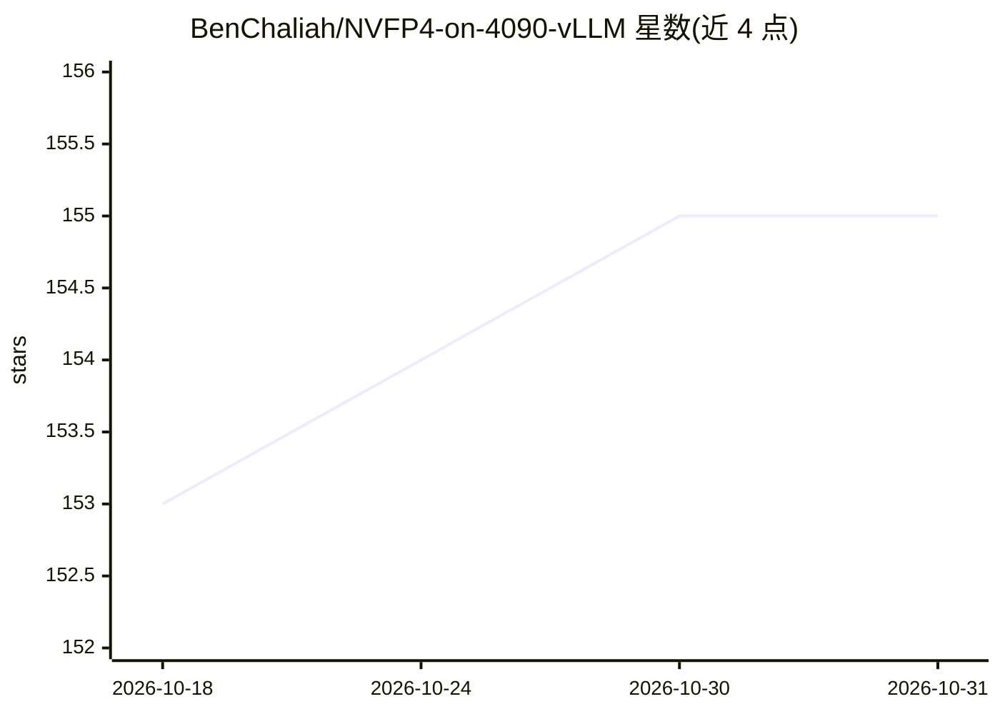

# BenChaliah/NVFP4-on-4090-vLLM

⭐ 155 · Python · 推送 2026-02-15 · [GitHub](https://github.com/BenChaliah/NVFP4-on-4090-vLLM) · 个人维护

**面向 RTX 4090 的 NVFP4/FP8 LLM 推理运行时**

AdaLLM 是针对 Ada Lovelace 架构 GPU（如 RTX 4090）的 NVFP4 优先推理运行时：加载 NVFP4 量化权重，KV cache 以 FP8 存储，解码走自定义 FP8 内核（含 Gemma3 滑动窗口注意力），保持 NVFP4 快速路径且不静默回退 FP16。支持 Qwen3（dense + MoE）与 Gemma3 文本模型，提供 OpenAI 兼容服务器与交互式 CLI（adallm serve/run）。MoE 推理可用但路由/卸载仍在优化，吞吐较低。README 给出 RTX 4090 上的分批吞吐与峰值显存基准数据。

## 筛选速览

| 维度 | 判定 | 备注 |
|---|---|---|
| AI 角色 | `ai-ecosystem` | LLM/agent 周边工具 |
| 许可风险 | `none` | — |
| 部署形态 | `library` | 以包/库形式分发 |
| 模型依赖 | — | README 未给出锁定关系 |
| 硬件要求 | — | 无带数字的原话,不猜 |
| 安装摩擦 | `medium` | 含编译或系统依赖之一 |
| 成熟度 | `idea` | |

## 能力要点

- NVFP4 权重 + FP8 KV cache + 自定义 FP8 解码内核
- 支持 Qwen3（dense/MoE）与 Gemma3 滑动窗口注意力
- OpenAI 兼容服务器与 adallm CLI（serve/run）
- 提供 RTX 4090 基准数据（吞吐、峰值显存）

## 适用场景

- 在 RTX 40 系显卡上以低显存运行 NVFP4 量化模型
- 本地部署 Qwen3/Gemma3 并对外提供 OpenAI 兼容 API
- 对 NVFP4+FP8 组合做吞吐与显存基准测试

## 场景标签

`推理引擎` `模型量化` · 领域:训练与推理

## 证据(README 行号)

> L3: AdaLLM is an NVFP4-first inference runtime for Ada Lovelace (e.g. RTX 4090) with FP8 KV cache and custom decode kern
> L81: 1. `adallm.runtime.LLMEngine` builds a scheduler and a model runner.

## 星数曲线

2026-10-18 153 → 2026-10-31 155（+2）

---
*卡片 v1 · prompt 1.4 · 生成 2026-10-22 · 置信度 high · 依据 README sha `717754aed1d1` · [字段定义](../../DATASET.md)*
