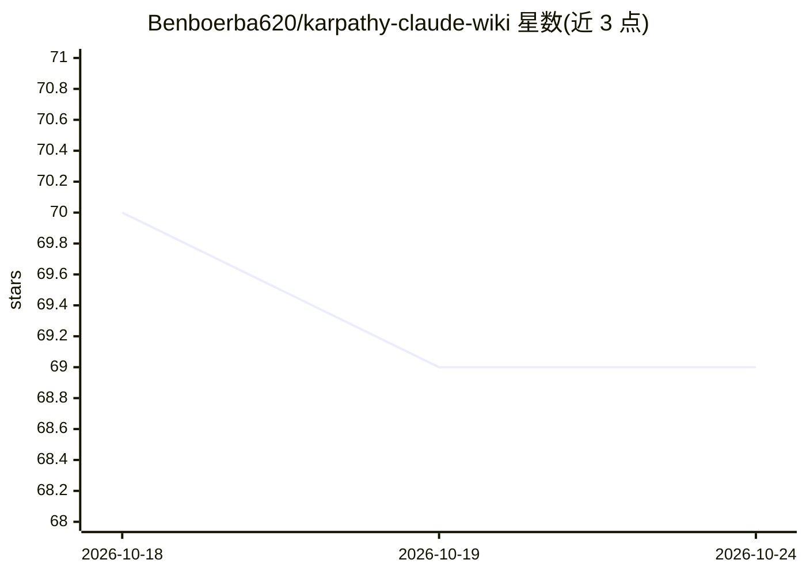

# Benboerba620/karpathy-claude-wiki

⭐ 69 · Python · MIT · 推送 2026-04-29 · [GitHub](https://github.com/Benboerba620/karpathy-claude-wiki) · [官网](https://x.com/karpathy/status/2039805659525644595) · 个人维护 · 中文 README

**供 AI agent 读写维护的个人 markdown wiki 空模板**

基于 Karpathy 推文理念的个人知识库模板：纯 markdown + frontmatter，刻意不使用向量库与 RAG。用户负责策展（把原始材料放进 raw/），AI agent 负责编译成结构化 sources 页面、更新 entities/concepts、建立交叉引用并标记矛盾。针对 Claude Code 优化，也兼容 Cursor/Cline/Windsurf 等任何能读写文件的 agent。提供 agent 对话安装、本地脚本安装（PowerShell/bash）、手动安装三条路径；可选外接 LLM 助手（Kimi/GLM/DeepSeek/Qwen/OpenAI）处理大文件 ingest，并提供 wiki_cli.py 命令式 ingest 与 /ingest slash command。

## 筛选速览

| 维度 | 判定 | 备注 |
|---|---|---|
| AI 角色 | `ai-ecosystem` | LLM/agent 周边工具 |
| 许可风险 | `permissive` | MIT |
| 部署形态 | `None` |  |
| 模型依赖 | locked-api |  |
| 硬件要求 | — | 无带数字的原话,不猜 |
| 安装摩擦 | `low` | 无编译、无系统依赖或容器化 |
| 成熟度 | — | 结构信号不足 |

## 能力要点

- 五层按变化速率组织的 wiki 结构（raw→sources→entities/concepts→explorations→rules）
- 不依赖向量库与 RAG，靠 LLM 上下文窗口直接读取维护
- 三端安装器 + Claude Code slash command（/ingest）+ 命令式 CLI ingest
- 可选大文件 ingest 外接 LLM 助手，支持 5 家 OpenAI 兼容 provider

## 适用场景

- 让 Claude Code 等 AI agent 帮我自动整理研究笔记并维护个人知识库
- 投研场景下追踪股票/实体相关的资料与个人规则
- 不懂数据库部署、只用 markdown 就搭建个人 LLM 知识库

## 场景标签

`知识库管理` `科研工具` · 领域:知识与检索

## 证据(README 行号)

> L23: > 一个个人 LLM 知识库模板，**灵感来自 Andrej Karpathy 的推文** —— 用 LLM 来构建和维护个人 wiki。本模板针对 Claude Code 优化，但任何能读写文件的 AI agent 都可以使用。
> L54: 一个基于 markdown 的个人 wiki，**用户负责策展，LLM 负责维护**。把一份研究笔记丢进 `wiki/raw/`，LLM 会自动把它编译成结构化的 `sources/` 页面、更新 `concepts/` 和 `e
> L65: **和 Notion / Obsidian / RAG 的关键区别**：传统知识库是写给"某天会回头读"的你的，所以维护成本最终会杀死它；这个模板是写给 **每次查询都读一遍** 的 LLM 的，维护成本由 LLM 承担——你只负

## 星数曲线

2026-10-18 70 → 2026-10-24 69（-1）

---
*卡片 v1 · prompt 1.4 · 生成 2026-10-24 · 置信度 high · 依据 README sha `b0175673e523` · [字段定义](../../DATASET.md)*
