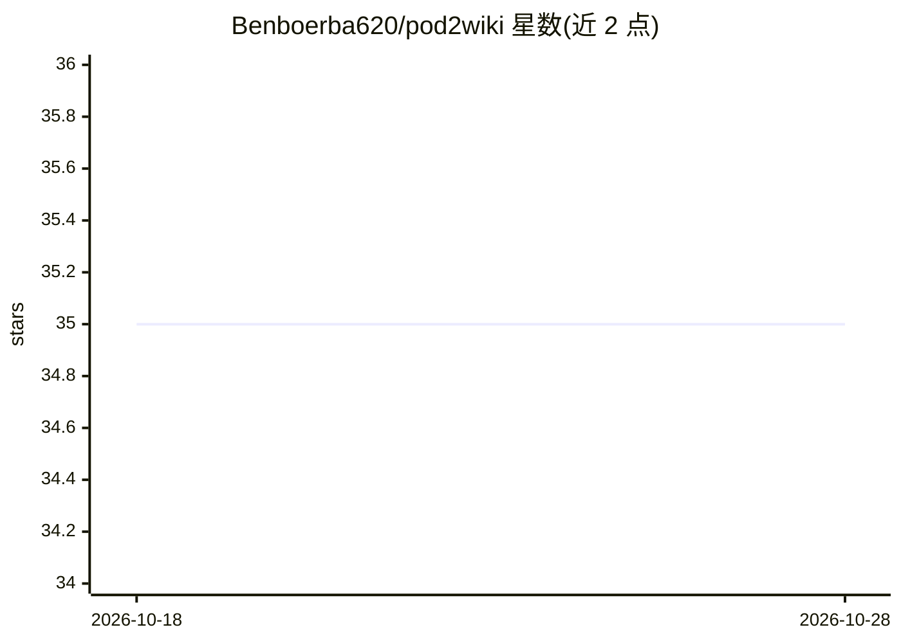

# Benboerba620/pod2wiki

⭐ 35 · Python · MIT · 推送 2026-04-29 · [GitHub](https://github.com/Benboerba620/pod2wiki) · 个人维护 · 中文 README

**把播客与长文 RSS 自动转成中文摘要写入个人 LLM 知识库**

pod2wiki 是 karpathy-claude-wiki 的信息输入层：从 YouTube 频道/搜索词与 RSS/博客订阅源抓取最近 N 天内容，按条件触发 Whisper 转录音频（描述过短且有音频链接时），再用 LLM（默认 DeepSeek V4 Flash，可换 Kimi/GLM/Qwen/OpenAI）生成中文摘要，写入 wiki 的 sources 与 raw 目录，并保留英文原文供后续二次翻译。默认配置为 AI 投研主题与 10 个来源，通过 config YAML 自定义主题、人物与频道。推荐由 Claude Code/Codex/Cursor 等 AI agent 按 INSTALL-FOR-AI.md 协议代为安装，无 GUI，YouTube 抓取可能触发限流。

## 筛选速览

| 维度 | 判定 | 备注 |
|---|---|---|
| AI 角色 | `ai-native` | 本体是模型或模型工具 |
| 许可风险 | `permissive` | MIT |
| 部署形态 | `None` |  |
| 模型依赖 | locked-api |  |
| 硬件要求 | — | 无带数字的原话,不猜 |
| 安装摩擦 | `low` | 无编译、无系统依赖或容器化 |
| 成熟度 | — | 结构信号不足 |

## 能力要点

- YouTube/RSS 双轨抓取 + 博客 RSS + 人物搜索词多路输入
- Whisper 条件触发转录（描述短于阈值且有音频链接时才跑）
- 默认 DeepSeek V4 Flash 生成中文摘要，OpenAI 兼容协议可切换提供商
- raw 英文原文永久保留，供任意 LLM 二次翻译，无需重抓音频

## 适用场景

- 自动追更我关注的播客和博客，沉淀为可检索的中文摘要知识页
- 搭建零代码 AI 投研信息流，按假设关键词归类摘要
- 把长期听的英文播客转成中文摘要加英文原文存档

## 场景标签

`知识库管理` `语音识别` `网页抓取` · 领域:效率与自动化

## 证据(README 行号)

> L6: > 🎙️ **30 秒看懂 / In 30 seconds**：把高质量播客（YouTube/RSS）和长文 RSS 自动转成中文摘要 + 英文原文存档，写进你的个人 LLM 知识库。Whisper 转录 + DeepSeek 翻译
> L23: pod2wiki 把高质量播客和长文 RSS 自动转成 `karpathy-claude-wiki` 兼容的 `source-summary` 页面。它是 wiki 的信息输入端：订阅源负责发现材料，脚本负责转录/摘要/写入，wi
> L122: > 💡 **关于 Whisper 触发条件**：只在 RSS description 短于 1500 字符（默认 `whisper.auto_threshold`）且有音频链接时才下 mp3 跑 Whisper。Substack

## 星数曲线

2026-10-18 35 → 2026-10-28 35（+0）

---
*卡片 v1 · prompt 1.4 · 生成 2026-10-25 · 置信度 high · 依据 README sha `2614178854bb` · [字段定义](../../DATASET.md)*
