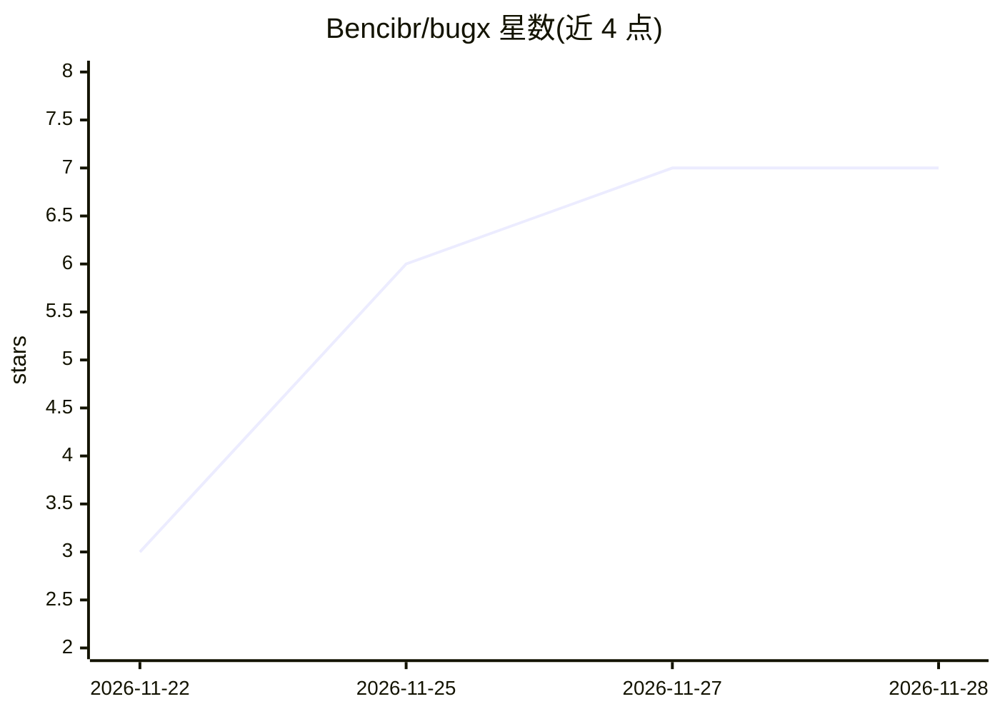

# Bencibr/bugx

⭐ 7 · Python · NOASSERTION · 推送 2026-11-27 · [GitHub](https://github.com/Bencibr/bugx) · [官网](https://bugx.dev) · 个人维护 · 中文 README

**装进 AI 编程助手的代码审计 Agent，输出可复现漏洞账本**

BugX 是通过 MCP 接入 Claude Code、Codex、Cline、OpenCode、ZCode 等宿主的代码审计 Agent，也可作独立 CLI 使用。它把项目拆成审计单元并维护覆盖清单（covered/blocked 状态），对每条漏洞要求两次攻击输入复现加一次正常输入零触发的验证，结论连同命令、退出码与产物哈希记入哈希链账本；支持断点续跑、并发 Worker、AAA 测试/PoC 生成与补丁包生成（默认 dry-run 不提交）。静态分析基于 tree-sitter，审计本地执行，云端同步为显式操作。需 Python ≥3.11。

## 筛选速览

| 维度 | 判定 | 备注 |
|---|---|---|
| AI 角色 | `ai-native` | 本体是模型或模型工具 |
| 许可风险 | `none` | NOASSERTION |
| 部署形态 | `library` | 以包/库形式分发 |
| 模型依赖 | — | README 未给出锁定关系 |
| 硬件要求 | — | 无带数字的原话,不猜 |
| 安装摩擦 | `low` | 无编译、无系统依赖或容器化 |
| 成熟度 | — | 结构信号不足 |

## 能力要点

- 覆盖清单账本：审计单元状态只有 covered/blocked，跟踪已查与未查范围
- 漏洞验证要求两正例一负对照三次执行，附复现命令与产物哈希
- 通过 MCP 接入 Claude Code、Codex、Cline、OpenCode、ZCode 等宿主
- 哈希链账本支持断点续跑与逐条复查，Web 报告实时预览

## 适用场景

- 让 AI 编程助手在提 PR 前对项目跑一遍安全审计
- 要求每条漏洞都附亲手可复现命令的安全检查
- 多项目长期积累错题集与审计经验并可跨设备同步
- 对测试用例做变异验证，检验其能否真的抓住 Bug

## 场景标签

`代码审查` `编码 Agent` `网络安全` · 领域:编码与开发

## 证据(README 行号)

> L7: BugX 是一款装在 AI 编程助手里的代码审计 Agent。**写完功能或提 PR 时让它跑一遍，它会自动完成审计，然后告诉你：查了哪些地方、哪些还没查、哪有漏洞——每个漏洞都附一条你能亲手复现的命令。** 目前已适配宿主：Cla
> L175: 一款装进 AI 编程助手的自主代码审计 Agent：通过 MCP 在 Claude Code、Codex、Cline、OpenCode、ZCode 内运行，也可作为独立 CLI 使用；按单元跟踪审计覆盖，并对每条发现做真实执行验
> L190: 基于 tree-sitter 的多语言静态与行为分析（Python、JavaScript/TypeScript、Java、Go、Rust 等），外加 native / Python / JVM / Electron / Andr

## 星数曲线

2026-11-22 3 → 2026-11-28 7（+4）

---
*卡片 v1 · prompt 1.4 · 生成 2026-11-22 · 置信度 high · 依据 README sha `bd440eb45287` · [字段定义](../../DATASET.md)*
