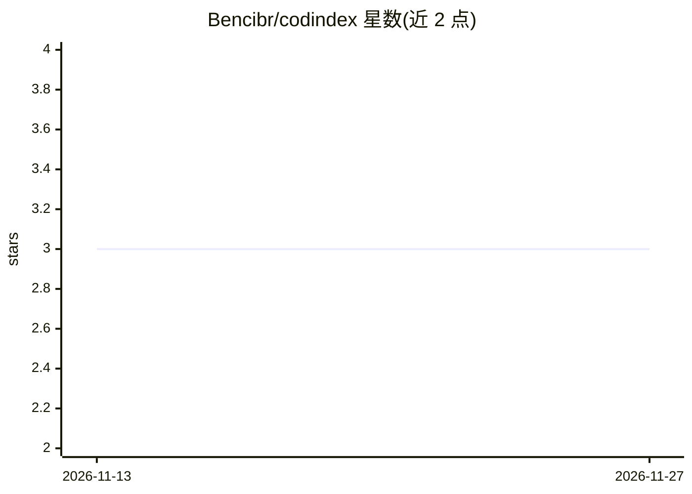

# Bencibr/codindex

⭐ 3 · TypeScript · MIT · 推送 2026-11-09 · [GitHub](https://github.com/Bencibr/codindex) · 个人维护 · 中文 README

**为 AI agent 提供本地代码库结构索引的 MCP 服务**

Codindex 用 tree-sitter 解析仓库 AST，把函数清单、调用图、模块依赖、控制流图与影响分析存入单个 SQLite 文件，通过 32 个 MCP 工具、4 个 Resource 和 1 个 Prompt 供客户端查询。支持 TypeScript/JavaScript/Python/Go/Rust/Java 六种语言，代码搜索走 SQLite FTS5，语义簇基于调用图 BFS。本地运行，不调 LLM API、不上传代码、无遥测。需 Node.js ≥ 22.5，单文件上限 1MB。README 附两轮 AI 效率基准，作者声明调用次数下降未能复现，可靠的是单次回传数据量减少。

## 筛选速览

| 维度 | 判定 | 备注 |
|---|---|---|
| AI 角色 | `ai-ecosystem` | LLM/agent 周边工具 |
| 许可风险 | `permissive` | MIT |
| 部署形态 | `library` | 以包/库形式分发 |
| 模型依赖 | — | README 未给出锁定关系 |
| 硬件要求 | — | 无带数字的原话,不猜 |
| 安装摩擦 | `low` | 无编译、无系统依赖或容器化 |
| 成熟度 | — | 结构信号不足 |

## 能力要点

- tree-sitter AST 解析生成调用图/依赖图/控制流，存单个 SQLite 文件
- 32 个 MCP 工具接入 Claude Code、Cursor、VS Code、Windsurf、Codex 等客户端
- 本地运行：无 LLM 调用、无上传、无遥测
- 文件变更 3 秒内增量同步，支持 incremental 扫描

## 适用场景

- 让 AI agent 不用逐文件读代码就拿到调用关系与影响面
- 重构前查询某个函数改动会波及哪些文件
- 查找死代码与可复用的现成实现

## 场景标签

`编码 Agent` · 领域:编码与开发

## 证据(README 行号)

> L13: **本地代码索引服务：用 MCP 把代码库结构交给 AI。**
> L23: 以 MCP server 接入 Claude Code、Cursor、VS Code、Windsurf、Codex 及任何支持
> L31: Codindex — a local-first code indexing, codebase indexing and code intelligence server for

## 星数曲线

2026-11-13 3 → 2026-11-27 3（+0）

---
*卡片 v1 · prompt 1.4 · 生成 2026-11-22 · 置信度 high · 依据 README sha `d623c9758bab` · [字段定义](../../DATASET.md)*
