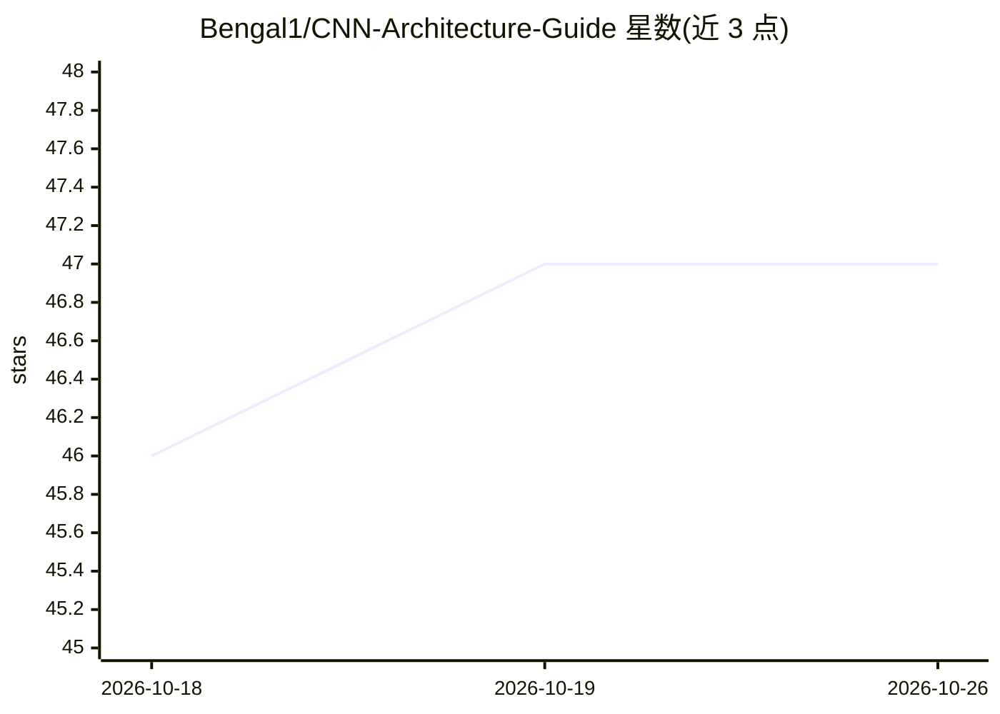

# Bengal1/CNN-Architecture-Guide

⭐ 47 · Python · MIT · 推送 2026-09-12 · [GitHub](https://github.com/Bengal1/CNN-Architecture-Guide) · 个人维护

**面向初学者的 PyTorch CNN 构建教程（理论+代码）**

以教学为目的的 CNN 入门指南仓库：围绕一个 6 层的 Simple CNN（2 卷积层、2 池化层、2 全连接层，含 Dropout 与 Batch Normalization），系统讲解全连接层、卷积层、池化层的原理与输出尺寸公式，覆盖激活函数、损失函数（MSE/Cross-Entropy 等）、梯度下降及其变体（SGD/Momentum/Adam 等）与正则化方法，并配合 PyTorch 代码实现。README 未给出安装或运行命令，限制为学习用途而非可复用的库或工具。

## 筛选速览

| 维度 | 判定 | 备注 |
|---|---|---|
| AI 角色 | `ai-knowledge` | 知识聚合/清单类 |
| 许可风险 | `permissive` | MIT |
| 部署形态 | `None` |  |
| 模型依赖 | — | README 未给出锁定关系 |
| 硬件要求 | — | 无带数字的原话,不猜 |
| 安装摩擦 | `low` | 无编译、无系统依赖或容器化 |
| 成熟度 | — | 结构信号不足 |

## 能力要点

- 以 6 层 Simple CNN 为载体讲解卷积/池化/全连接层原理
- 覆盖激活函数、损失函数、梯度下降变体与正则化的公式推导
- 理论讲解与 PyTorch 代码实现相结合

## 适用场景

- 初学者系统理解 CNN 的工作原理与实现
- 作为深度学习入门课程或自学的参考资料
- 查阅卷积输出尺寸、损失函数等常用公式

## 场景标签

`教程课程` · 领域:学习与行业

## 证据(README 行号)

> L11: This repository provides a guide for building *Convolutional Neural Networks (CNNs)* in PyTorch, aimed at beginners
> L14: This repository is built for learning purposes and helps beginners get started with coding neural networks and unde

## 星数曲线

2026-10-18 46 → 2026-10-26 47（+1）

---
*卡片 v1 · prompt 1.4 · 生成 2026-10-25 · 置信度 high · 依据 README sha `51a877383088` · [字段定义](../../DATASET.md)*
