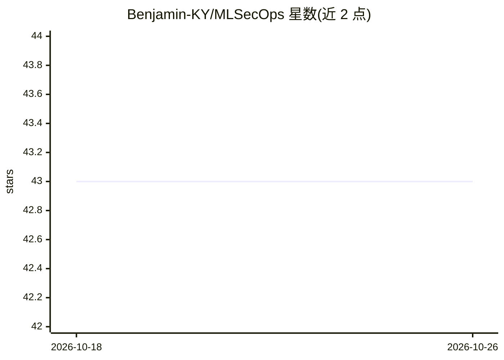

# Benjamin-KY/MLSecOps

⭐ 43 · 推送 2026-07-10 · [GitHub](https://github.com/Benjamin-KY/MLSecOps) · 个人维护

**MLSecOps（AI/ML 安全运营）策展资源清单：框架、组织与工具**

整合机器学习与安全运营的资源汇编仓库，收录 2024-2025 行业动态（并购、监管）、安全框架（OWASP LLM Top 10 2025、MITRE ATLAS、NIST AI RMF、ISO/IEC 42001、EU AI Act）、治理标准、社区组织与按类别的安全工具清单（如 LLM 防护栏类）。面向在 AI/ML 环境中实施安全的从业者与研究者，以文档形式组织，不含可运行代码。

## 筛选速览

| 维度 | 判定 | 备注 |
|---|---|---|
| AI 角色 | `ai-knowledge` | 知识聚合/清单类 |
| 许可风险 | `permissive` | — |
| 部署形态 | `library` | 以包/库形式分发 |
| 模型依赖 | — | README 未给出锁定关系 |
| 硬件要求 | — | 无带数字的原话,不猜 |
| 安装摩擦 | `low` | 无编译、无系统依赖或容器化 |
| 成熟度 | — | 结构信号不足 |

## 能力要点

- 汇编 OWASP/MITRE/NIST/ISO/EU AI Act 等框架与监管要求
- 收录 2024-2025 行业并购与 agentic AI 安全动态
- 按类别组织安全工具清单（首类为 LLM 防护栏）
- 收录社区、会议与研究机构资源链接

## 适用场景

- 查找 AI/ML 安全相关框架与标准出处
- 了解 2024-2025 MLSecOps 领域的工具与组织生态
- 为 AI 系统合规（EU AI Act、ISO 42001）寻找参考资源

## 场景标签

`精选清单` `网络安全` · 领域:学习与行业

## 证据(README 行号)

> L8: This repository serves as a comprehensive resource for integrating machine learning with security operations (MLSecO
> L16: **MLSecOps** (Machine Learning Security Operations) is the practice of building security into the complete lifecycl

## 星数曲线

2026-10-18 43 → 2026-10-26 43（+0）

---
*卡片 v1 · prompt 1.4 · 生成 2026-10-25 · 置信度 mid · 依据 README sha `eb0a96052eeb` · [字段定义](../../DATASET.md)*
