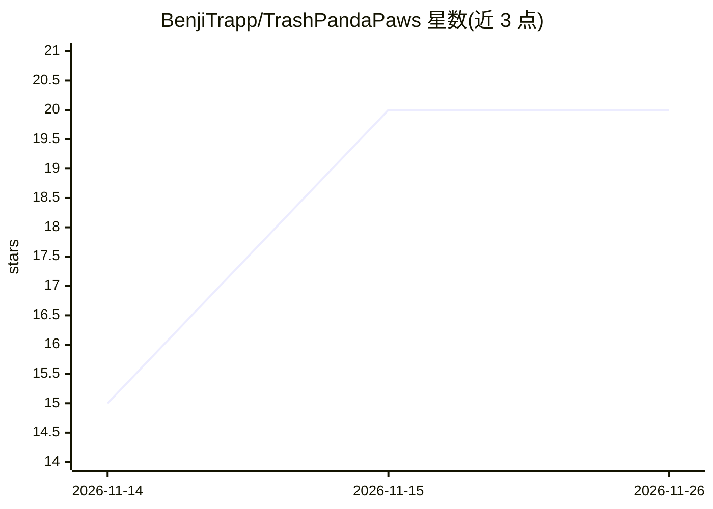

# BenjiTrapp/TrashPandaPaws

⭐ 20 · Python · 推送 2026-11-25 · [GitHub](https://github.com/BenjiTrapp/TrashPandaPaws) · [官网](https://benjitrapp.github.io/trashpandapaws-network-implant/) · 个人维护

**红队硬件植入体：RPi4/CM4 内联网线窃听与 C2 回联设备**

面向授权渗透测试的硬件植入体：在 Raspberry Pi 4 或 CM4 定制载板上以内联 Ethernet tap 形式透明桥接并捕获流量，由 PoE 供电，伪装成 Cisco IP 电话或 HP 打印机，支持 802.1X NAC 绕过。Beacon 为纯 Python 标准库实现，支持 HTTPS/SMB/QUIC/DNS 多通道回联与 AES-256-GCM 加密，配套 Flask 团队服务器 GUI、反向 SOCKS 隧道与 16 个 Impacket 工具。AI 部分：操作 GUI 内的可选 LLM agent 模式，八阶段自动化攻击、不可逆动作拒绝门与 Markdown 报告。硬件提供 Lite（全现货零件）/v1 HAT（概念阶段，注明不可制造）/v2 CM4 三种构建，目前可运行的是 Lite 变体。

## 筛选速览

| 维度 | 判定 | 备注 |
|---|---|---|
| AI 角色 | `ai-enhanced` | 去掉 AI 部分产品仍成立 |
| 许可风险 | `none` | — |
| 部署形态 | `self-host` | docker 或自建部署 |
| 模型依赖 | — | README 未给出锁定关系 |
| 硬件要求 | — | 无带数字的原话,不猜 |
| 安装摩擦 | `low` | 无编译、无系统依赖或容器化 |
| 成熟度 | `idea` | |

## 能力要点

- 内联 Ethernet tap + PoE 供电，伪装为 Cisco IP Phone 7960 或 HP LaserJet M478
- 纯 Python stdlib beacon，零外部依赖，HTTPS/SMB/QUIC/DNS 四通道自动回退
- Flask 团队服务器 GUI：终端、文件浏览器、8 套 Malleable C2 流量配置、16 个 Impacket 工具
- 操作 GUI 内可选 LLM agent 模式：八阶段攻击活动，8 类不可逆动作直接拒绝、11 类每次询问

## 适用场景

- 授权红队演练中在目标网络内部署隐蔽回联点
- 绕过 802.1X NAC 做内网流量捕获与横向移动
- 通过反向 SOCKS 隧道从目标网络内部运行 nmap/浏览器
- 用 LLM agent 模式自动化执行多阶段攻击并产出带证据的报告

## 场景标签

`网络安全` · 领域:学习与行业

## 证据(README 行号)

> L14: Red Team network hardware implant built on a Raspberry Pi 4 with a custom PCB HAT,
> L24: The Raccoon Implant is an inline Ethernet tap that bridges two network ports on a custom HAT
> L46: |**Automated Attack**|Optional LLM agent mode inside the operator GUI: eight-phase campaigns, a gate where eight ir

## 星数曲线

2026-11-14 15 → 2026-11-26 20（+5）

---
*卡片 v1 · prompt 1.4 · 生成 2026-11-18 · 置信度 mid · 依据 README sha `532c2fcf68e7` · [字段定义](../../DATASET.md)*
