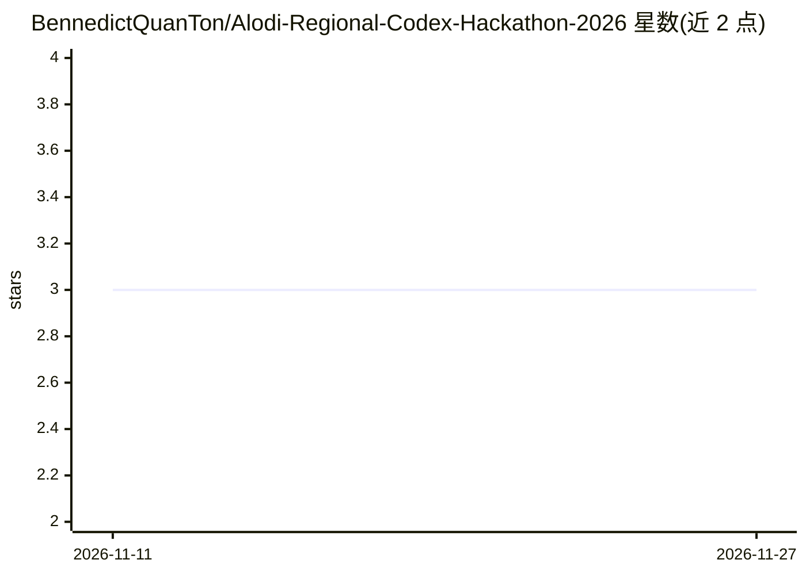

# BennedictQuanTon/Alodi-Regional-Codex-Hackathon-2026

⭐ 3 · Python · 推送 2026-11-02 · [GitHub](https://github.com/BennedictQuanTon/Alodi-Regional-Codex-Hackathon-2026) · [官网](https://alodi-ai-system.vercel.app/) · 组织维护

**越南电商最后一公里失败配送的 agent 式挽回系统**

面向越南电商（以 Shopee 场景为背景）的末端配送挽回系统：派送前向买家征询配送时间窗；配送失败后快递员一键触发挽回流程，系统先以聊天联系买家，60 分钟无回应后发起披露并经买家同意的 AI 语音通话，从对话中抽取时间窗、投放点与代收人等结构化字段。模型输出仅作提议，由后端规则门控决定是否生效（置信度阈值、通话时段、次数上限等），不确定或拒绝的情形转人工并全程留审计痕迹。本地以 uv + Node.js 运行，默认桩响应无需 API key，实时通话需付费 OpenAI 请求。

## 筛选速览

| 维度 | 判定 | 备注 |
|---|---|---|
| AI 角色 | `ai-native` | 本体是模型或模型工具 |
| 许可风险 | `none` | — |
| 部署形态 | `desktop` | 安装包/桌面程序 |
| 模型依赖 | — | README 未给出锁定关系 |
| 硬件要求 | — | 无带数字的原话,不猜 |
| 安装摩擦 | `medium` | 含编译或系统依赖之一 |
| 成熟度 | — | 结构信号不足 |

## 能力要点

- 一键触发聊天+AI 语音的外联流程，产出供下一位快递员使用的上下文卡片
- 结构化字段抽取置信度≥0.85 才自动更新，其余经聊天确认或转人工
- 后端业务规则门控全部 agent 动作，含审计轨迹与客户服务决策
- 默认桩模式无需 OpenAI key；实时模式支持越南语语音通话与语音备忘录转录

## 适用场景

- 快递员派送失败后一键发起买家挽回沟通
- 运营侧按业务步骤查看流水线、策略守卫与异常队列
- 卖家希望降低拒收退回造成的损失

## 场景标签

`语音 Agent` `聊天机器人` `工作流自动化` · 领域:效率与自动化

## 证据(README 行号)

> L19: A failed delivery is a negotiation that happens off the system: a missed call, and everything that could fix the ne
> L151: |**GPT-Live-1**|Natural voice calls in Vietnamese|`v1/live/sessions`|In this build|
> L171: |**Working, local**|Backend with SQLite, scheduler, rules, audit trail and customer-service decisions, on 4,000 ma

## 星数曲线

2026-11-11 3 → 2026-11-27 3（+0）

---
*卡片 v1 · prompt 1.4 · 生成 2026-11-22 · 置信度 high · 依据 README sha `8df030d54c7a` · [字段定义](../../DATASET.md)*
