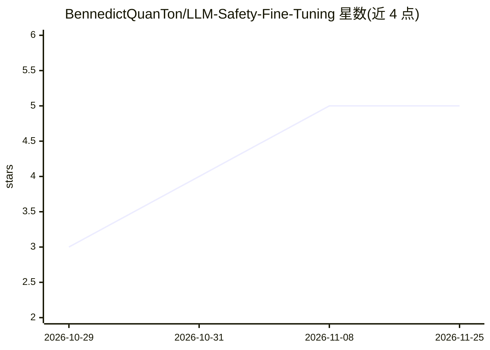

# BennedictQuanTon/LLM-Safety-Fine-Tuning

⭐ 5 · Python · MIT · 推送 2026-10-13 · [GitHub](https://github.com/BennedictQuanTon/LLM-Safety-Fine-Tuning) · 个人维护

**在免费 Kaggle GPU 上对 Qwen2.5-3B 做 QLoRA 安全微调的 notebook 流水线**

以 Kaggle notebook 形式提供的参数高效微调（QLoRA）流水线：对 Qwen2.5-3B-Instruct 做越南语监督微调，目标行为包括指令遵循与严格 JSON 输出、对直接/间接提示注入的鲁棒性、以及仅基于上下文回答并在无法回答时弃权。流水线分数据准备、SFT、行为评测、多 run 对比四步，每步输出 run_record.json 可复现记录；训练过程产出八面板健康诊断图并自动给出 HEALTHY/OVERFIT/UNDERFIT/UNSTABLE 判定。另含独立的越狱分类器轨道（DeBERTa-v3 + Qwen QLoRA）。全部步骤在 Kaggle T4 上运行，无需本地机器；默认流程约耗 3–5 小时 GPU（每周 30 小时配额）。

## 筛选速览

| 维度 | 判定 | 备注 |
|---|---|---|
| AI 角色 | `ai-ecosystem` | LLM/agent 周边工具 |
| 许可风险 | `permissive` | MIT |
| 部署形态 | `None` |  |
| 模型依赖 | — | README 未给出锁定关系 |
| 硬件要求 | — | 无带数字的原话,不猜 |
| 安装摩擦 | `low` | 无编译、无系统依赖或容器化 |
| 成熟度 | — | 结构信号不足 |

## 能力要点

- QLoRA 微调 Qwen2.5-3B：拒绝注入/越狱、严格 JSON、无答案时弃权三类行为
- 每次训练产出八面板健康诊断图与自动诊断码（HEALTHY/OVERFIT/UNDERFIT/UNSTABLE）
- 多 run 基准对比：单变量改动的排名、Δ-vs-baseline 效果表与超参效应图
- 独立越狱/prompt 注入分类器轨道，按锁定 hold-out 集的 ROC-AUC 评分

## 适用场景

- 在免费 Kaggle T4 上低成本复现小模型安全对齐实验
- 通过 Copy & Edit 单变量变体做微调配置的基准对比
- 评测模型在提示注入与越狱场景下的拒绝与弃权行为
- 用分类器识别良性 prompt 与越狱/注入请求

## 场景标签

`微调` `模型评测` · 领域:评测与运维

## 证据(README 行号)

> L3: A reproducible, notebook-based pipeline for **parameter-efficient supervised fine-tuning (SFT)** of small instructio
> L11: Every heavy step runs on Kaggle; nothing needs to run on a local machine.

## 星数曲线

2026-10-29 3 → 2026-11-25 5（+2）

---
*卡片 v1 · prompt 1.4 · 生成 2026-11-21 · 置信度 high · 依据 README sha `a9bb15ccb9b7` · [字段定义](../../DATASET.md)*
