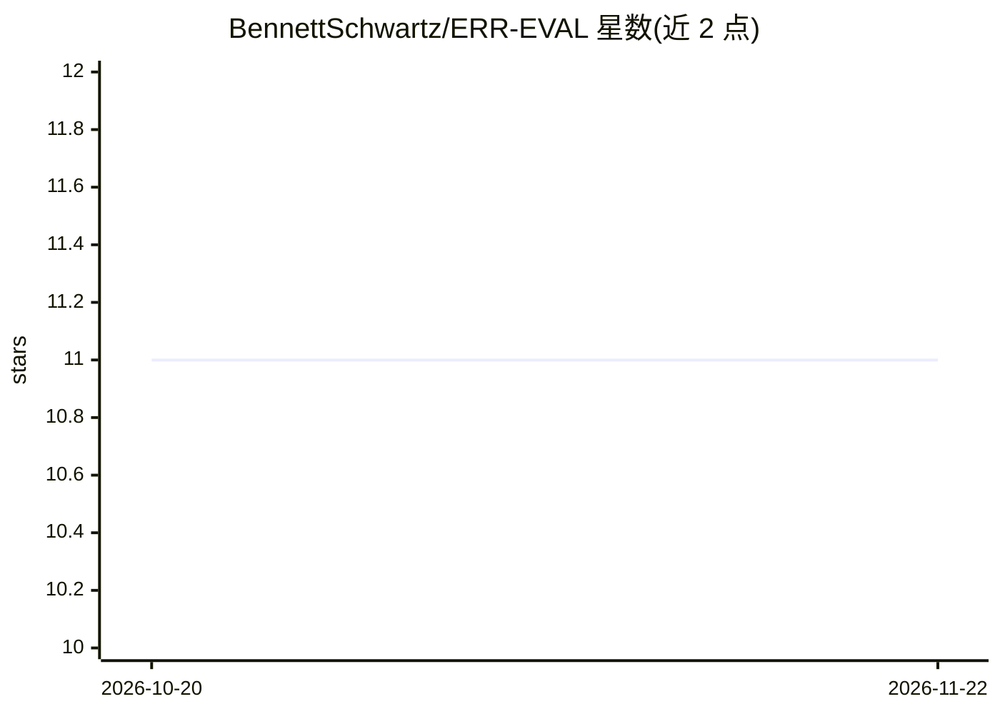

# BennettSchwartz/ERR-EVAL

⭐ 11 · Python · MIT · 推送 2026-03-22 · [GitHub](https://github.com/BennettSchwartz/ERR-EVAL) · [官网](https://err-eval.gustycube.com/) · 个人维护

**评估 LLM 认知可靠性的基准：测试模型应对不确定性与幻觉**

ERR-EVAL（Epistemic Reasoning & Reliability Evaluation）是一个认知可靠性基准，测量 AI 模型在输入不完整、含噪、误导或自相矛盾时能否检测歧义、避免幻觉、定位不确定点并保持校准的置信度。采用 5 轴评分准则（每轴 0–2 分），包含 5 个评测轨道。通过 OpenRouter API key 运行评测命令，结果保存为 JSON 供前端排行榜可视化，前端部署于 GitHub Pages。MIT 许可。

## 筛选速览

| 维度 | 判定 | 备注 |
|---|---|---|
| AI 角色 | `ai-ecosystem` | LLM/agent 周边工具 |
| 许可风险 | `permissive` | MIT |
| 部署形态 | `library` | 以包/库形式分发 |
| 模型依赖 | locked-api |  |
| 硬件要求 | — | 无带数字的原话,不猜 |
| 安装摩擦 | `low` | 无编译、无系统依赖或容器化 |
| 成熟度 | — | 结构信号不足 |

## 能力要点

- 5 轴评分准则：歧义检测/幻觉避免/不确定性定位/回应策略/认知语气
- 5 个评测轨道：噪声感知、语义歧义、错误前提陷阱、欠约束任务、冲突约束
- 支持单模型评测与批量运行全部配置模型
- 结果 JSON 驱动 GitHub Pages 排行榜

## 适用场景

- 评测模型在不完整或误导输入下是否会编造事实
- 对比多个模型的置信度校准表现
- 批量跑分并生成可视化排行榜

## 场景标签

`模型评测` · 领域:评测与运维

## 证据(README 行号)

> L3: **ERR-EVAL** (Epistemic Reasoning & Reliability Evaluation) is an epistemic reliability benchmark that measures whet
> L53: python -m erreval evaluate --model "openai/gpt-5.2" --limit 25

## 星数曲线

2026-10-20 11 → 2026-11-22 11（+0）

---
*卡片 v1 · prompt 1.4 · 生成 2026-11-19 · 置信度 high · 依据 README sha `cc9672f428bc` · [字段定义](../../DATASET.md)*
