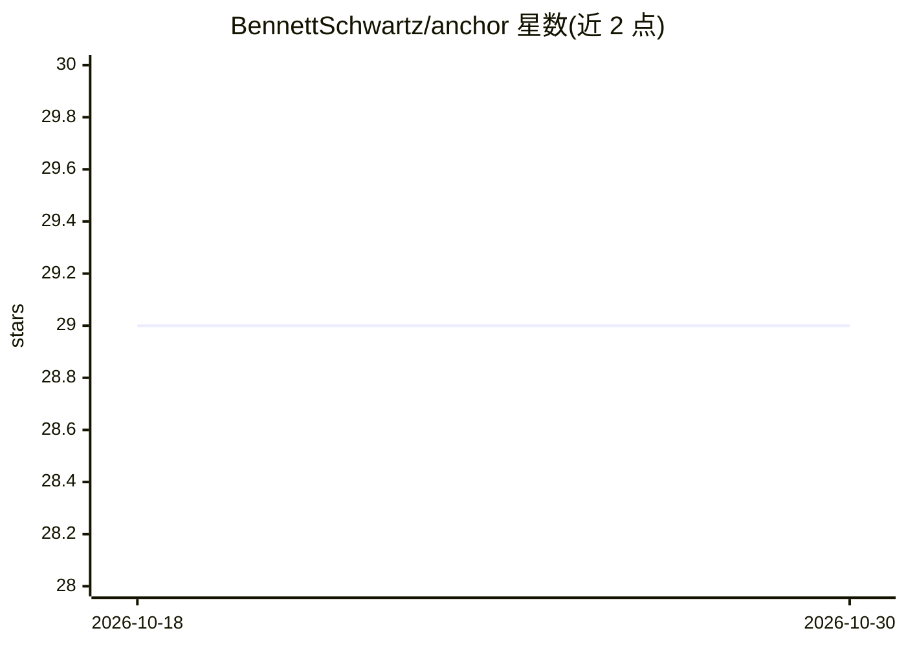

# BennettSchwartz/anchor

⭐ 29 · Go · NOASSERTION · 推送 2026-04-17 · [GitHub](https://github.com/BennettSchwartz/anchor) · 个人维护

**AI 代理授权的离线确定性验证开放协议**

定义三个签名对象（Capability、ActionEnvelope、TrustBundle）与一个验证函数：签发平台预先签署能力凭证，代理在每次行动时附带凭证，服务端通过 14 项确定性检查（签名、有效期、作用域、委托深度、重放检测等）在本地完成验证，无需网络调用。提供 Go/TypeScript/Python/Java 四个 SDK 与一致性测试套件，附带威胁模型、信任模型与治理流程文档。面向需要为 AI 代理行动做授权验证的开发者与服务方。

## 筛选速览

| 维度 | 判定 | 备注 |
|---|---|---|
| AI 角色 | `ai-ecosystem` | LLM/agent 周边工具 |
| 许可风险 | `permissive` | NOASSERTION |
| 部署形态 | `None` |  |
| 模型依赖 | — | README 未给出锁定关系 |
| 硬件要求 | — | 无带数字的原话,不猜 |
| 安装摩擦 | `low` | 无编译、无系统依赖或容器化 |
| 成熟度 | — | 结构信号不足 |

## 能力要点

- Capability/ActionEnvelope/TrustBundle 三对象签名模型，离线本地验证
- 14 项确定性检查，产出机器可读 reason_codes 供审计
- Go/TypeScript/Python/Java 四个 SDK，reason code 一致性由测试套件门控
- 提供规范、威胁模型、信任模型与 RFC 治理文档

## 适用场景

- 为接受 AI 代理调用的服务增加授权核验层
- 在无网络或低延迟要求场景下做离线授权决策
- 对代理行动做可审计的拒绝原因记录

## 场景标签

 · 领域:AI 代理安全/协议

## 证据(README 行号)

> L22: When an AI agent takes an action on behalf of a user -- calling an API, writing to a database, triggering a workflo
> L26: Anchor solves this with a signed artifact model: the platform that grants the agent its permissions signs a **Capab
> L105: All four SDKs implement the full offline verifier surface with pluggable crypto providers. Reason code parity is e

## 星数曲线

2026-10-18 29 → 2026-10-30 29（+0）

---
*卡片 v1 · prompt 1.4 · 生成 2026-10-26 · 置信度 high · 依据 README sha `dc0793f7419a` · [字段定义](../../DATASET.md)*
