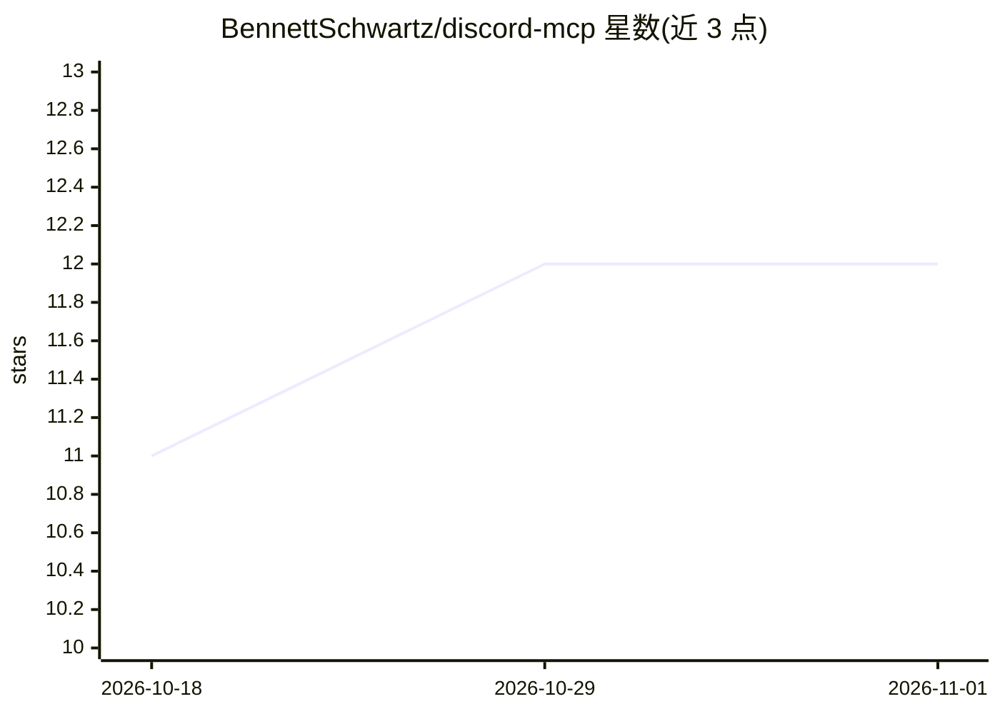

# BennettSchwartz/discord-mcp

⭐ 12 · TypeScript · MIT · 推送 2026-01-12 · [GitHub](https://github.com/BennettSchwartz/discord-mcp) · [官网](http://discord-mcp.gustycube.com/) · 个人维护

**为 AI agent 提供安全访问 Discord API 的 MCP 服务器**

一个 Model Context Protocol（MCP）服务器，向 AI agent 开放 Discord 的 REST API 与 Gateway 实时事件：提供 120+ 个 Discord API 工具，覆盖消息收发编辑、用户/服务器信息、频道与线程操作、webhook、文件上传与审核管理等。安全机制包括服务器/频道白名单、默认安全配置与防止意外提及。采用声明式 API 目录自动生成工具，支持模块化按需启用，可接入 Claude Desktop。

## 筛选速览

| 维度 | 判定 | 备注 |
|---|---|---|
| AI 角色 | `ai-ecosystem` | LLM/agent 周边工具 |
| 许可风险 | `permissive` | MIT |
| 部署形态 | `None` |  |
| 模型依赖 | — | README 未给出锁定关系 |
| 硬件要求 | — | 无带数字的原话,不猜 |
| 安装摩擦 | `low` | 无编译、无系统依赖或容器化 |
| 成熟度 | — | 结构信号不足 |

## 能力要点

- 120+ Discord API 工具，覆盖 REST API
- 服务器/频道白名单与安全默认值
- Gateway 集成支持实时 Discord 事件订阅
- 模块化工具包按需启用功能

## 适用场景

- 让 AI agent 在 Discord 中收发消息、管理频道与审核
- 为 Claude Desktop 等客户端接入 Discord 能力
- 订阅 Discord 实时事件供 agent 响应

## 场景标签

`Agent 框架` · 领域:Agent 开发

## 证据(README 行号)

> L3: A **Model Context Protocol** server that provides AI agents with secure access to Discord's REST API and Gateway eve
> L11: 🔧 **120+ Discord API Tools** - Complete coverage of Discord's REST API

## 星数曲线

2026-10-18 11 → 2026-11-01 12（+1）

---
*卡片 v1 · prompt 1.4 · 生成 2026-11-01 · 置信度 high · 依据 README sha `d53702f0ef70` · [字段定义](../../DATASET.md)*
