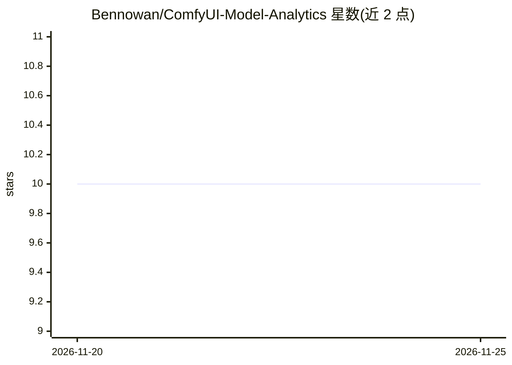

# Bennowan/ComfyUI-Model-Analytics

⭐ 10 · JavaScript · NOASSERTION · 推送 2026-11-17 · [GitHub](https://github.com/Bennowan/ComfyUI-Model-Analytics) · 个人维护

**ComfyUI 扩展：分析模型使用情况并找出未用模型**

作为 ComfyUI 自定义节点安装后，扩展扫描磁盘上的模型目录（含 extra_model_paths.yaml 声明的路径），解析已保存的 workflow JSON 中引用的模型，并在运行时挂钩模型加载与队列提交记录实际使用。按可配置的最近使用时间窗口将模型分为 Used/Unused，帮助定位可释放的磁盘空间；同时以包为单位统计 Custom Node 的活动与成功执行。只读取不修改模型文件、workflow 与已安装包，历史与偏好本地存储。

## 筛选速览

| 维度 | 判定 | 备注 |
|---|---|---|
| AI 角色 | `ai-ecosystem` | LLM/agent 周边工具 |
| 许可风险 | `none` | NOASSERTION |
| 部署形态 | `None` |  |
| 模型依赖 | — | README 未给出锁定关系 |
| 硬件要求 | — | 无带数字的原话,不猜 |
| 安装摩擦 | `low` | 无编译、无系统依赖或容器化 |
| 成熟度 | — | 结构信号不足 |

## 能力要点

- 磁盘扫描 + workflow 解析 + 运行时加载挂钩三种使用来源
- 可配置时间窗口的 Used/Unused 分类，非破坏性只读检查
- Custom Node 包级统计：区分活动图参与与真实成功执行（排除缓存命中）
- 支持英/德/简中/繁中/日/韩六种界面语言

## 适用场景

- 清理不再使用的 checkpoint/LoRA 文件以释放磁盘空间
- 查看哪些 Custom Node 包真正参与了生成流程
- 排查 workflow 中引用但长期未加载的模型

## 场景标签

 · 领域:AI 生成工具/模型管理

## 证据(README 行号)

> L3: A local ComfyUI analytics extension for understanding model usage and discovering which installed Custom Node packag
> L19: - **Disk Scan:** Walks through all known model directories on your disk to find files.
> L21: - **Live Tracking:** Hooks into model loading to record what actually gets loaded at runtime, and also notes which 

## 星数曲线

2026-11-20 10 → 2026-11-25 10（+0）

---
*卡片 v1 · prompt 1.4 · 生成 2026-11-20 · 置信度 high · 依据 README sha `d5f5f478598f` · [字段定义](../../DATASET.md)*
