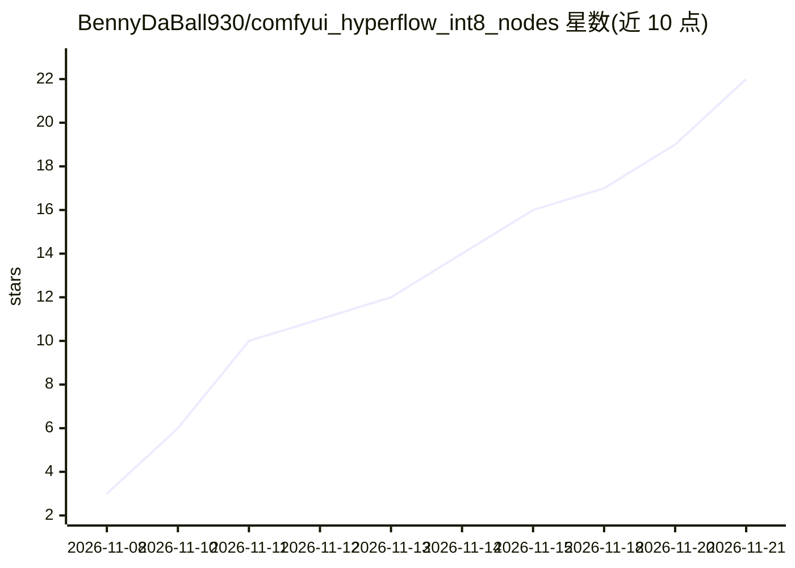

# BennyDaBall930/comfyui_hyperflow_int8_nodes

⭐ 22 · Python · GPL-3.0 · 推送 2026-11-15 · [GitHub](https://github.com/BennyDaBall930/comfyui_hyperflow_int8_nodes) · 个人维护

**ComfyUI 加载 HyperFlow H3 Flash INT8 检查点的自定义节点包**

非官方 ComfyUI 节点包，在 ComfyUI 原生 INT8 convrot 内核上运行 HyperFlow H3 Flash 的 fl2va 与 ref2va 两个 INT8 检查点，实现文本/首帧/首末帧/参考图到视频（含同步立体声）生成。提供 HyperFlow INT8 Loader、可让原生 MiniMax H3 LoRA 适配剪枝模型的 HyperFlow LoRA 节点及 6 个工作流模板。需配套官方 ComfyUI-HyperFlow-Flash 包，权重常驻约需 16 GB VRAM（峰值 24.2 GB，RTX 5090）。

## 筛选速览

| 维度 | 判定 | 备注 |
|---|---|---|
| AI 角色 | `ai-ecosystem` | LLM/agent 周边工具 |
| 许可风险 | `viral` | GPL-3.0 |
| 部署形态 | `library` | 以包/库形式分发 |
| 模型依赖 | — | README 未给出锁定关系 |
| 硬件要求 | `gpu-24g` | |
| 安装摩擦 | `low` | 无编译、无系统依赖或容器化 |
| 成熟度 | — | 结构信号不足 |

## 能力要点

- INT8 Loader 节点支持 fl2va 与 ref2va 两个检查点
- HyperFlow LoRA 节点重编号块索引，使 MiniMax H3 LoRA 适配剪枝后的低秩模型
- 提供 6 个即用工作流模板（文生视频/首帧/首末帧/参考图等）
- 检查点以 ComfyUI 原生 int8_tensorwise+convrot 方案量化，托管于 Hugging Face

## 适用场景

- 在 ComfyUI 中以 INT8 内核运行 HyperFlow H3 Flash 视频生成
- 在剪枝模型上使用为完整 MiniMax H3 训练的 LoRA
- 通过模板快速跑通 4-8 步蒸馏采样的视频工作流

## 场景标签

`视频生成` · 领域:内容生成

## 证据(README 行号)

> L24: - **HyperFlow INT8 Loader**, a ComfyUI node that runs both HyperFlow checkpoints: `fl2va` (text, first frame, first
> L191: |Model detection, MiniMax-H3 blocks, INT8 weight loading and GEMMs, attention, sampler|ComfyUI core, unchanged|
> L194: |`HyperFlow INT8 Loader` node|This pack (`loader.py`)|

## 星数曲线

2026-11-08 3 → 2026-11-21 22（+19）

---
*卡片 v1 · prompt 1.4 · 生成 2026-11-18 · 置信度 mid · 依据 README sha `d50cfaa4d2d3` · [字段定义](../../DATASET.md)*
