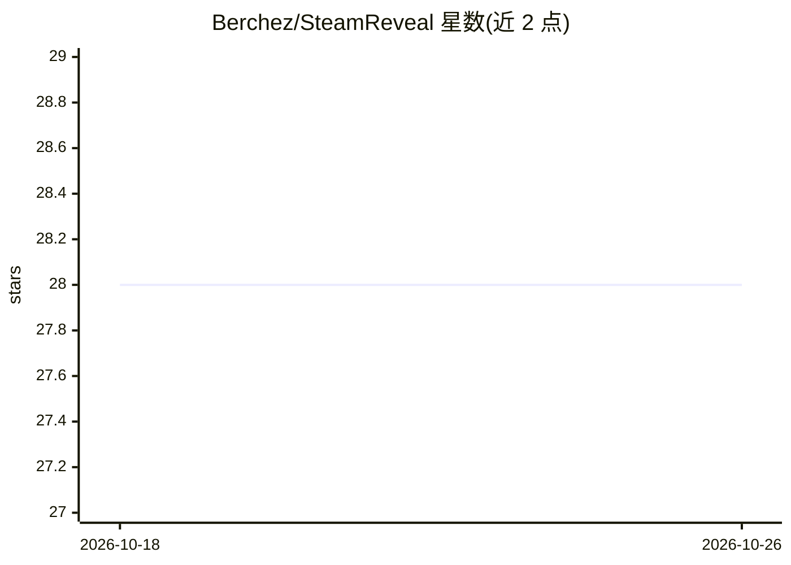

# Berchez/SteamReveal

⭐ 28 · TypeScript · 推送 2026-10-10 · [GitHub](https://github.com/Berchez/SteamReveal) · [官网](https://steam-reveal.vercel.app) · 个人维护

**分析 Steam 玩家公开数据，推断其可能位置与密友圈，并给出 CS 作弊概率**

基于 Next.js/TypeScript 的 OSINT 工具，面向 Steam 社区用户：通过好友间公开位置数据的三角化推断目标玩家最可能的位置，按共同好友权重绘制前 20 名密友图谱；针对 Counter-Strike 玩家，Flask 后端的机器学习模型结合评论情感、好友封禁接近度、账号年龄/投入与游戏统计估算作弊概率，Faceit/GamersClub 封禁会直接提升该概率。数据来源为 SteamAPI 与公开资料抓取，支持英/葡/俄/德/西五种语言。README 未给出安装运行命令，仅提供在线访问链接。

## 筛选速览

| 维度 | 判定 | 备注 |
|---|---|---|
| AI 角色 | `ai-enhanced` | 去掉 AI 部分产品仍成立 |
| 许可风险 | `none` | — |
| 部署形态 | `None` |  |
| 模型依赖 | — | README 未给出锁定关系 |
| 硬件要求 | — | 无带数字的原话,不猜 |
| 安装摩擦 | `low` | 无编译、无系统依赖或容器化 |
| 成熟度 | — | 结构信号不足 |

## 能力要点

- 基于密友公开位置三角化推断玩家可能位置
- 按共同连接权重生成前 20 名密友社交图谱
- 机器学习模型估算 CS 玩家作弊概率（评论情感、封禁史、账号年龄与游戏统计）
- 支持英/葡/俄/德/西多语言界面

## 适用场景

- 查询 Steam 玩家可能所在地区与其密友圈
- 对 CS 玩家生成作弊概率报告辅助判断
- 玩家自行调整隐私设置前了解公开信息暴露程度

## 场景标签

`网络安全` · 领域:学习与行业

## 证据(README 行号)

> L23: - **Geographic Triangulation (General Steam):** Discovers any player's most likely location by analyzing the public
> L25: - **AI Cheater Probability (CS Exclusive):** Calculates the likelihood of a user being a cheater using a machine le
> L39: - **AI/ML Backend:** Integration with a Flask-based prediction model for CS cheater probability.

## 星数曲线

2026-10-18 28 → 2026-10-26 28（+0）

---
*卡片 v1 · prompt 1.4 · 生成 2026-10-26 · 置信度 high · 依据 README sha `694019cfce61` · [字段定义](../../DATASET.md)*
