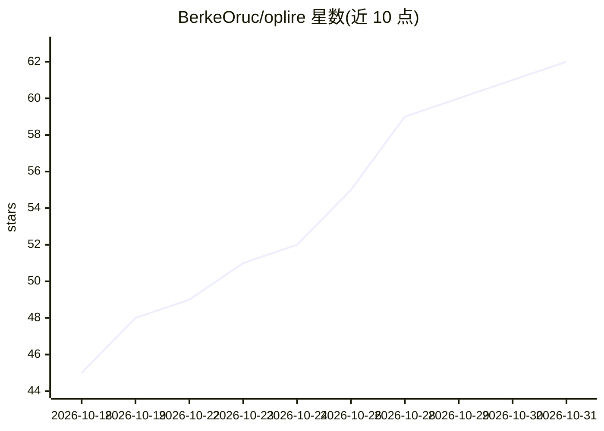

# BerkeOruc/oplire

⭐ 62 · Rust · MIT · 推送 2026-10-10 · [GitHub](https://github.com/BerkeOruc/oplire) · [官网](https://berkeai.com) · 个人维护

**轮换 WARP IP 重置 OpenCode 限额并代理 Claude Code 接入免费模型**

Rust 编写的双用途 CLI 工具：一是通过停止/清除/重建 Cloudflare WARP 隧道轮换 IP，重置 OpenCode 的速率限制；二是在本机 8080 端口运行反向代理，将 Anthropic API 格式转译为 OpenAI 格式，使 Claude Code 接入 OpenCode Zen 的免费模型（GLM/MiniMax/Kimi/Qwen/Llama），并在收到 429 时自动重置 WARP。提供 AUR、winget、Homebrew 与源码编译四种安装方式。

## 筛选速览

| 维度 | 判定 | 备注 |
|---|---|---|
| AI 角色 | `ai-ecosystem` | LLM/agent 周边工具 |
| 许可风险 | `permissive` | MIT |
| 部署形态 | `None` |  |
| 模型依赖 | — | README 未给出锁定关系 |
| 硬件要求 | — | 无带数字的原话,不猜 |
| 安装摩擦 | `medium` | 含编译或系统依赖之一 |
| 成熟度 | — | 结构信号不足 |

## 能力要点

- WARP 隧道重置实现 IP 轮换，绕过 OpenCode 按 IP 的限额
- 反向代理将 Anthropic API 格式转译为 OpenAI 格式并流式转发 SSE
- 429 限流时自动透明重置 WARP
- oplire connect claude-code 一条命令启动代理并拉起 Claude Code

## 适用场景

- OpenCode 触发限流后快速重置 IP 恢复使用
- 让 Claude Code 使用 OpenCode Zen 的免费模型
- 后台守护模式监控 OpenCode 并自动处理限流

## 场景标签

`模型网关` · 领域:Agent 开发

## 证据(README 行号)

> L16: 1. **WARP Rate Limit Reset** - Rotates your IP via Cloudflare WARP to reset OpenCode rate limits
> L29: Claude Code → oplire proxy (127.0.0.1:8080) → OpenCode Zen
> L30: - Translates Anthropic API format to OpenAI format

## 星数曲线

2026-10-18 45 → 2026-10-31 62（+17）

---
*卡片 v1 · prompt 1.4 · 生成 2026-10-24 · 置信度 high · 依据 README sha `a4c498a03901` · [字段定义](../../DATASET.md)*
