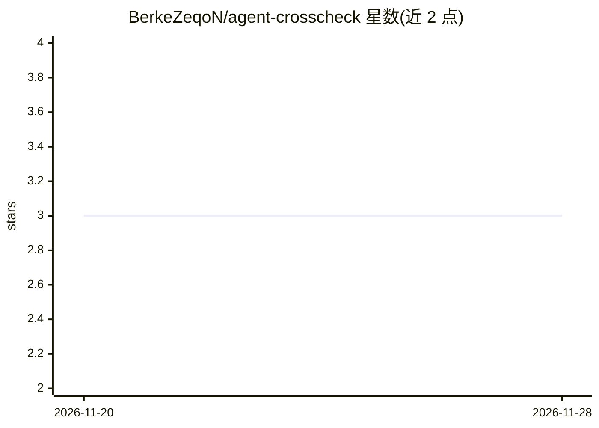

# BerkeZeqoN/agent-crosscheck

⭐ 3 · Python · MIT · 推送 2026-10-27 · [GitHub](https://github.com/BerkeZeqoN/agent-crosscheck) · 个人维护

**让多个 AI 编码代理互相审查发现，产出共识修复清单**

一个 Python 脚本工具：把 Claude Code、Codex、Antigravity、Gemini CLI、Cursor、opencode 及任意文本模型拉入同一代码评审会话。每个代理研究代码并以 path:line 证据写发现，按环形结构相互质询，用 KABUL/RED/KISMEN 三种裁决（协议工作语言为土耳其语）确认或驳斥，超时后合并达成共识的发现到 final.md 并删除其余文件。通过 install.py 把 skill 复制到各工具目录，无第三方依赖，需 Python 3.8+。脚本本身不做网络调用。

## 筛选速览

| 维度 | 判定 | 备注 |
|---|---|---|
| AI 角色 | `ai-ecosystem` | LLM/agent 周边工具 |
| 许可风险 | `permissive` | MIT |
| 部署形态 | `None` |  |
| 模型依赖 | local-ok | 支持本地模型 |
| 硬件要求 | — | 无带数字的原话,不猜 |
| 安装摩擦 | `low` | 无编译、无系统依赖或容器化 |
| 成熟度 | — | 结构信号不足 |

## 能力要点

- 多代理环形互审：每个发现须由另一代理复现证据后才算共识
- KABUL/RED/KISMEN 三态裁决协议，捕获错误行号与虚构 API
- install.py 自动检测本机 AI 工具并安装/更新 skill（含备份）
- 本地浏览器聊天面板实时查看会话，支持 --replay 回放

## 适用场景

- 发布前让多个 AI 代理交叉评审项目是否可上线
- 对单个代理的代码评审结论做二次核验
- 让无技能系统的文本模型经 drive 命令参与评审循环

## 场景标签

`多智能体` `代码审查` · 领域:Agent 开发

## 证据(README 行号)

> L12: **Let several AI coding agents review the same project and check each other's work, until one agreed list of fixes 
> L48: python install.py            # copies the skill into every AI tool it finds
> L111: python install.py`. Requires Python 3.8+ and nothing else.

## 星数曲线

2026-11-20 3 → 2026-11-28 3（+0）

---
*卡片 v1 · prompt 1.4 · 生成 2026-11-22 · 置信度 high · 依据 README sha `c1937b2e945f` · [字段定义](../../DATASET.md)*
