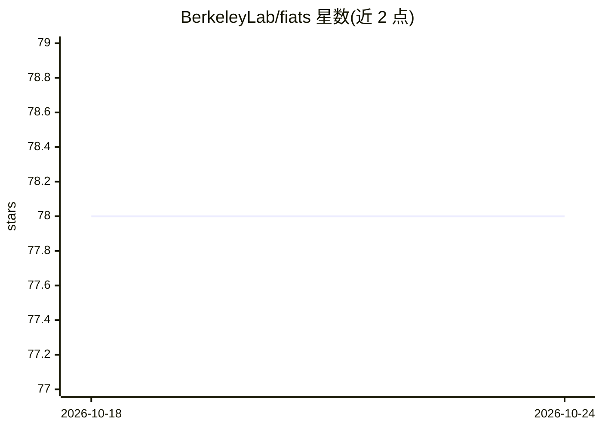

# BerkeleyLab/fiats

⭐ 78 · Fortran · NOASSERTION · 推送 2026-10-10 · [GitHub](https://github.com/BerkeleyLab/fiats) · 组织维护

**Fortran 2023 编写的科学计算神经网络代理模型训练与推断库**

面向计算科学的高性能计算场景，用现代 Fortran（2023）编写神经网络代理模型（surrogate）训练与推断库。支持前馈网络与残差网络（仅推断），提供 SGD/Adam 优化器及 Sigmoid/RELU/GELU/Swish 等激活函数；通过 do concurrent 与多镜像（SMPD）机制暴露并行化机会，JSON 文件读写超参数与网络配置，可经 nexport 导入 PyTorch 模型做推断。需 fpm 与 LLVM flang-new 19+/NAG nagfor 7.2+ 等编译器从源码构建；GNU 与 Intel 编译器仅部分版本可用，GPU 卸载为实验特性。

## 筛选速览

| 维度 | 判定 | 备注 |
|---|---|---|
| AI 角色 | `ai-native` | 本体是模型或模型工具 |
| 许可风险 | `none` | NOASSERTION |
| 部署形态 | `None` |  |
| 模型依赖 | — | README 未给出锁定关系 |
| 硬件要求 | — | 无带数字的原话,不猜 |
| 安装摩擦 | `low` | 无编译、无系统依赖或容器化 |
| 成熟度 | `idea` | |

## 能力要点

- 纯 Fortran 2023 实现的神经网络训练与推断库，服务计算科学代理模型
- 基于 do concurrent 与多镜像执行暴露编译器自动并行化机会（CPU 并行批推断已可用）
- JSON 格式导入导出超参数与网络；经 nexport 转换 PyTorch 模型做推断
- 提供 ICAR 云微物理代理训练、E3SM 气溶胶推断等科学应用示例

## 适用场景

- 为大气/地球系统等科学计算模块训练神经网络代理模型
- 在 Fortran HPC 代码中原生嵌入神经网络推断
- 评估 Fortran 编译器对 do concurrent 等并行特性的支持

## 场景标签

`模型训练` `推理引擎` · 领域:训练与推理

## 证据(README 行号)

> L15: Fiats supports research on the training and deployment of neural-network surrogate models for computational science
> L16: Fiats also provides a platform for exploring and advancing the native parallel programming features of Fortran 2023

## 星数曲线

2026-10-18 78 → 2026-10-24 78（+0）

---
*卡片 v1 · prompt 1.4 · 生成 2026-10-24 · 置信度 high · 依据 README sha `c1b52186f930` · [字段定义](../../DATASET.md)*
