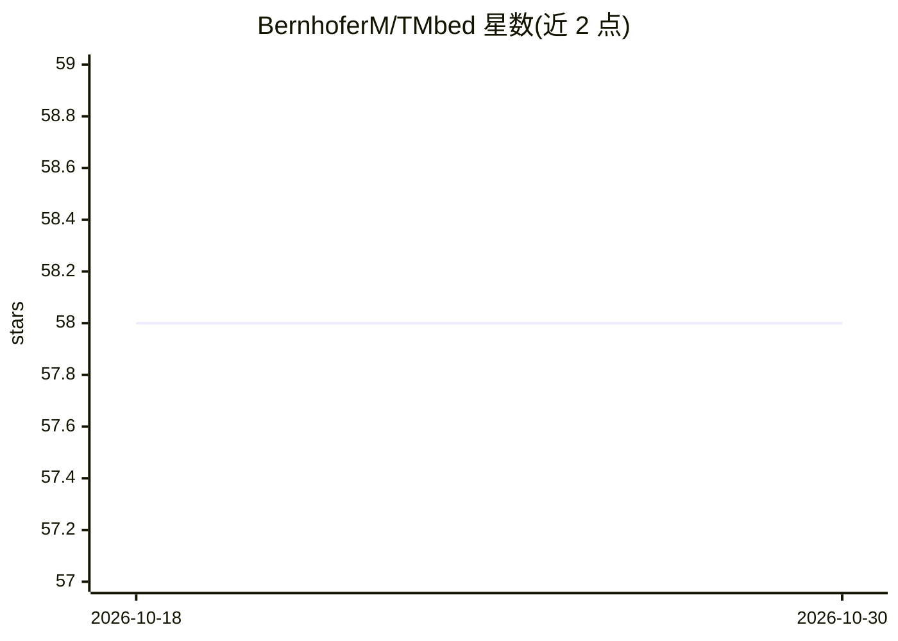

# BernhoferM/TMbed

⭐ 58 · Python · Apache-2.0 · 推送 2026-02-24 · [GitHub](https://github.com/BernhoferM/TMbed) · 个人维护

**预测跨膜蛋白及其区段与信号肽的生物信息学工具**

基于蛋白质语言模型 ProtT5-XL-U50 生成嵌入，预测跨膜 β 桶蛋白与 α 螺旋蛋白、跨膜区段的位置与方向及信号肽。提供 embed 与 predict 两条命令，输入 FASTA 文件，可在 GPU 或 CPU 上运行；首次使用时自动下载 2.25 GB 的 ProtT5 编码器。支持 5 种输出格式，含残基级类别标签与概率。另提供人类蛋白质组与 Swiss-Prot 的预计算预测下载，以及 Google Colab 试用入口。面向生物信息学科研用户。

## 筛选速览

| 维度 | 判定 | 备注 |
|---|---|---|
| AI 角色 | `ai-native` | 本体是模型或模型工具 |
| 许可风险 | `permissive` | Apache-2.0 |
| 部署形态 | `library` | 以包/库形式分发 |
| 模型依赖 | — | README 未给出锁定关系 |
| 硬件要求 | `cpu-ok` | |
| 安装摩擦 | `low` | 无编译、无系统依赖或容器化 |
| 成熟度 | — | 结构信号不足 |

## 能力要点

- 用 ProtT5-XL-U50 嵌入预测跨膜 β 桶与 α 螺旋区段及方向
- 预测信号肽，残基级输出类别与概率
- 5 种输出格式，支持 GPU/CPU 运行与可复现性设置
- 提供人类蛋白质组与 Swiss-Prot 预计算预测

## 适用场景

- 从 FASTA 序列批量预测跨膜蛋白及区段拓扑
- 预测蛋白的信号肽与膜内外方向
- 直接查看已有预计算的人类蛋白质组跨膜注释

## 场景标签

 · 领域:生物信息学/蛋白质预测

## 证据(README 行号)

> L7: TMbed predicts transmembrane beta barrel and alpha helical proteins, the position and orientation of their transmemb
> L8: We use a Protein Language Model, ProtT5-XL-U50 [1], to generate embeddings used as input for our method.

## 星数曲线

2026-10-18 58 → 2026-10-30 58（+0）

---
*卡片 v1 · prompt 1.4 · 生成 2026-10-24 · 置信度 high · 依据 README sha `3ef93051c745` · [字段定义](../../DATASET.md)*
