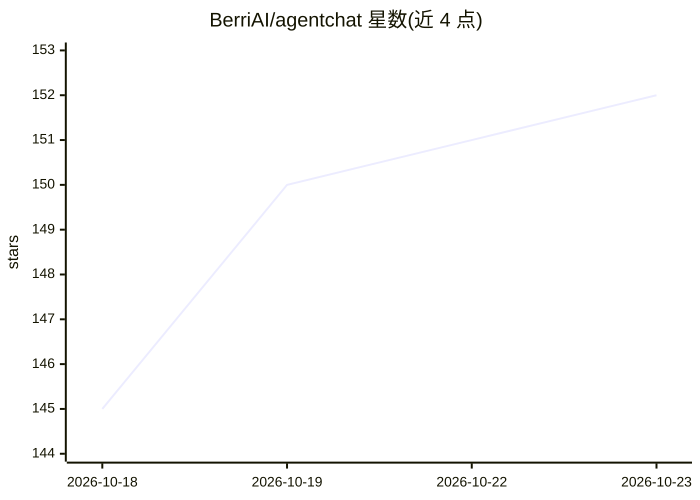

# BerriAI/agentchat

⭐ 152 · Rust · MIT · 推送 2026-10-19 · [GitHub](https://github.com/BerriAI/agentchat) · 组织维护

**将 AI agent 连接到 Slack/Teams 等聊天渠道的 Python SDK**

提供统一 SDK，把用任意 agent 框架（Claude Agent SDK、OpenAI Agents、LangChain DeepAgents、Pydantic AI、LangGraph）构建的 agent 接入 Slack、Teams、iMessage、WhatsApp、Discord、Telegram 六种渠道，各渠道通过 install extra 安装。共享 Rust 核心，提供 Python、Node.js/TypeScript、Rust 接口；原生 Node/Rust 渠道目前仅支持 Slack。从源码安装需 Rust 工具链，已发布的二进制 wheel 无需编译器。

## 筛选速览

| 维度 | 判定 | 备注 |
|---|---|---|
| AI 角色 | `ai-ecosystem` | LLM/agent 周边工具 |
| 许可风险 | `permissive` | MIT |
| 部署形态 | `library` | 以包/库形式分发 |
| 模型依赖 | locked-api |  |
| 硬件要求 | — | 无带数字的原话,不猜 |
| 安装摩擦 | `low` | 无编译、无系统依赖或容器化 |
| 成熟度 | — | 结构信号不足 |

## 能力要点

- 支持 6 种聊天渠道（Slack/Teams/iMessage/WhatsApp/Discord/Telegram）
- 兼容 Claude Agent SDK、OpenAI Agents、LangChain DeepAgents、Pydantic AI 等多种 agent SDK
- 共享 Rust 核心，提供 Python/Node.js/Rust 接口
- 会话与渠道对话的映射机制（如 Claude session、LangGraph checkpointer）

## 适用场景

- 把自己写的 agent 一份代码同时接入多个聊天平台
- 让 Claude/OpenAI 等 agent 在 Slack 或 Teams 里回复消息
- 为不同 agent SDK 统一聊天渠道接入层

## 场景标签

`Agent 框架` · 领域:Agent 开发

## 证据(README 行号)

> L9: a minimal sdk to connect your agents to slack, teams, imessage, whatsapp, telegram.
> L11: use any SDK (Claude Agents, OpenAI Agents, Langchain DeepAgents, Pydantic Agents) and instantly connect it to all s

## 星数曲线

2026-10-18 145 → 2026-10-23 152（+7）

---
*卡片 v1 · prompt 1.4 · 生成 2026-10-22 · 置信度 high · 依据 README sha `dd4a3bff9de6` · [字段定义](../../DATASET.md)*
