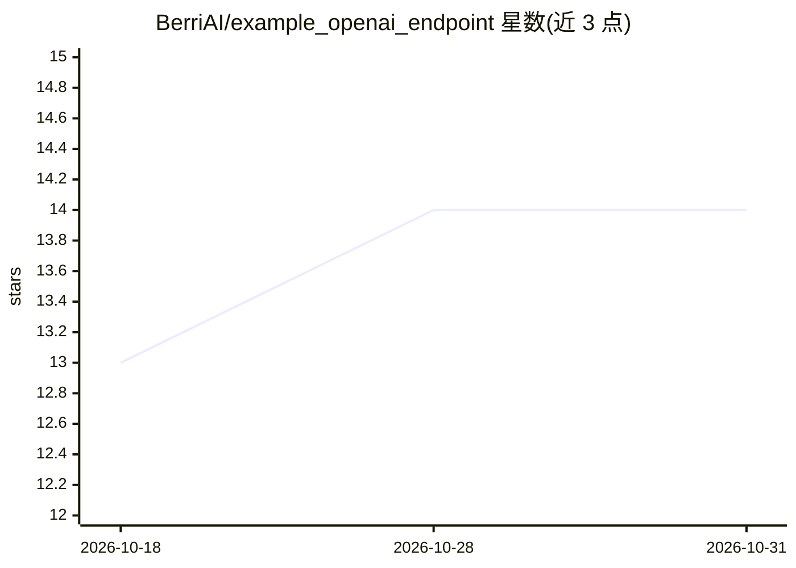

# BerriAI/example_openai_endpoint

⭐ 14 · Python · 推送 2026-09-26 · [GitHub](https://github.com/BerriAI/example_openai_endpoint) · 组织维护

**OpenAI /chat/completions 端点的示例实现**

BerriAI 维护的示例项目，实现一个 OpenAI 风格的 /chat/completions 端点。README 仅含标题与一句描述，未提供安装步骤、依赖说明或使用方法，需查阅仓库代码了解具体运行方式。从命名与描述可推断其面向需要在自有服务中复现 OpenAI 聊天补全接口形式的开发者。

## 筛选速览

| 维度 | 判定 | 备注 |
|---|---|---|
| AI 角色 | `ai-ecosystem` | LLM/agent 周边工具 |
| 许可风险 | `none` | — |
| 部署形态 | `None` |  |
| 模型依赖 | — | README 未给出锁定关系 |
| 硬件要求 | — | 无带数字的原话,不猜 |
| 安装摩擦 | `low` | 无编译、无系统依赖或容器化 |
| 成熟度 | — | 结构信号不足 |

## 能力要点

- 实现 OpenAI 风格的 /chat/completions 端点

## 适用场景

- 参考实现 OpenAI 兼容的聊天补全接口

## 场景标签

 · 领域:LLM 基础设施/API

## 证据(README 行号)

> L1: # example_openai_endpoint
> L2: An example OpenAI /chat/completions endpoint

## 星数曲线

2026-10-18 13 → 2026-10-31 14（+1）

---
*卡片 v1 · prompt 1.4 · 生成 2026-10-31 · 置信度 low · 依据 README sha `54b4b515e5fc` · [字段定义](../../DATASET.md)*
