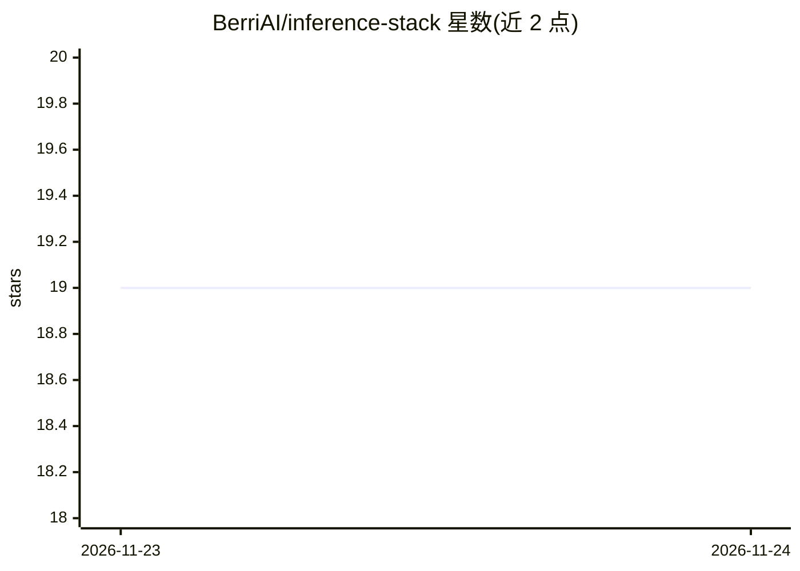

# BerriAI/inference-stack

⭐ 28 · Python · MIT · 推送 2026-11-23 · [GitHub](https://github.com/BerriAI/inference-stack) · [官网](https://inferencestack.io) · 组织维护

**一键部署的开源推理栈：整合 LiteLLM、llm-d、vLLM 与 Grafana**

提供一条安装命令即可部署的推理栈：应用请求经 LiteLLM 做模型路由，llm-d 依据缓存与队列数据选择 vLLM 副本，Hugging Face 提供模型权重，Grafana 展示 Prometheus 采集的指标。支持 Docker Compose 单机部署、Kubernetes Helm 部署或 AWS 账户内租用 GPU；无 GPU 时可开启模拟模式返回固定响应。部署后通过 localhost:8080 管理界面选择模型并测试请求。

## 筛选速览

| 维度 | 判定 | 备注 |
|---|---|---|
| AI 角色 | `ai-ecosystem` | LLM/agent 周边工具 |
| 许可风险 | `permissive` | MIT |
| 部署形态 | `self-host` | docker 或自建部署 |
| 模型依赖 | local-ok | 支持本地模型 |
| 硬件要求 | — | 无带数字的原话,不猜 |
| 安装摩擦 | `low` | 无编译、无系统依赖或容器化 |
| 成熟度 | — | 结构信号不足 |

## 能力要点

- 一条 curl 安装命令完成 Docker 或 Kubernetes 部署
- LiteLLM 统一 API 入口与模型管理，llm-d 按缓存/队列数据路由到 vLLM 副本
- 无 GPU 可启用模拟模式获取固定响应
- AWS 一键建栈，部署前可对比模型预估 GPU 显存与价格

## 适用场景

- 在自己的 AWS 账户里快速搭起一套模型推理服务
- 单机用 Docker Compose 本地运行推理栈并查看 Grafana 指标
- 无 GPU 环境下先以模拟模式试用部署流程

## 场景标签

`模型网关` `推理引擎` · 领域:Agent 开发

## 证据(README 行号)

> L13: Apps send requests to LiteLLM for model routing, then llm-d selects a vLLM replica. Hugging Face supplies model wei
> L3: ### Everything you need to own your inference. Deploy with one command.

## 星数曲线

2026-11-23 19 → 2026-11-24 19（+0）

---
*卡片 v1 · prompt 1.4 · 生成 2026-11-23 · 置信度 high · 依据 README sha `bbf288e8ab4d` · [字段定义](../../DATASET.md)*
