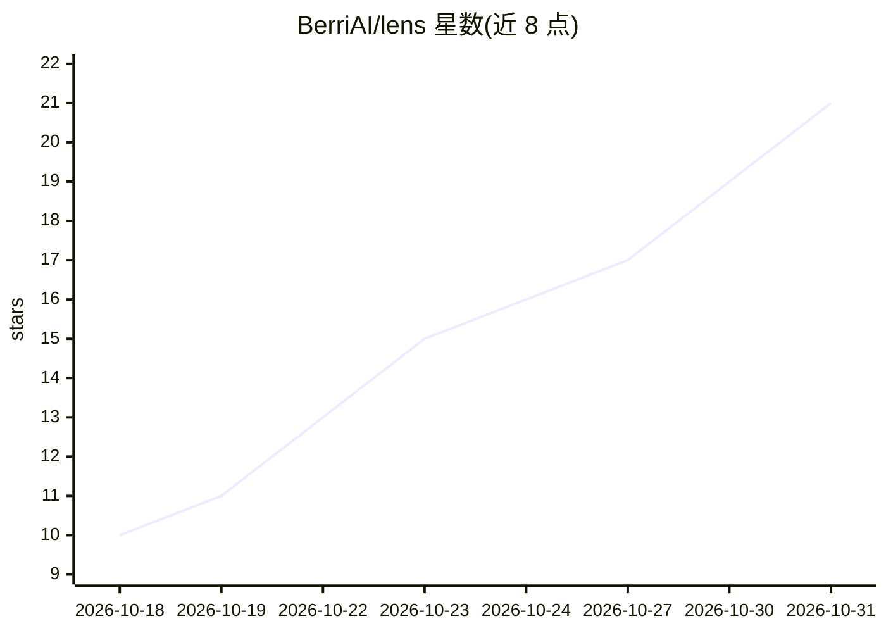

# BerriAI/lens

⭐ 21 · Rust · NOASSERTION · 推送 2026-10-30 · [GitHub](https://github.com/BerriAI/lens) · 组织维护

**AI agent 的追踪与调查平台，可独立或嵌入 LiteLLM**

BerriAI 维护的追踪与调查平台：agent 运行经 LiteLLM 网关汇成每 run 一条 trace，Lens 记录输入、输出与工具调用，定位运行中的问题并反馈给 agent 用于改进。可独立运行或嵌入 LiteLLM 界面，trace 数据存储在用户自己的 ClickHouse 中，支持将 trace 指向 Claude Code 或 Codex 供 agent 使用。提供 Git/Docker 本地启动方式及供编码 agent 使用的配置提示词。当前为 Early access 阶段。

## 筛选速览

| 维度 | 判定 | 备注 |
|---|---|---|
| AI 角色 | `ai-ecosystem` | LLM/agent 周边工具 |
| 许可风险 | `none` | NOASSERTION |
| 部署形态 | `None` |  |
| 模型依赖 | — | README 未给出锁定关系 |
| 硬件要求 | — | 无带数字的原话,不猜 |
| 安装摩擦 | `low` | 无编译、无系统依赖或容器化 |
| 成熟度 | `idea` | |

## 能力要点

- agent 运行汇聚为每 run 一条 trace（含输入/输出/工具调用）
- 可独立运行或嵌入 LiteLLM，数据保留在用户自己的 ClickHouse
- 可生成 trace 数据集并将发现反馈给 agent
- 支持编码 agent（Claude Code/Codex）读取 trace 改进 agent

## 适用场景

- 调查 AI agent 运行中哪里出了问题
- 在自有基础设施上留存 LLM 调用的完整追踪
- 让 Claude Code/Codex 基于追踪数据改进自己的 agent

## 场景标签

`LLM 可观测性` · 领域:评测与运维

## 证据(README 行号)

> L17: Agent swarms flow through the LiteLLM gateway into one trace per run, and Lens loops what it learns back into your 
> L30: **Run Lens on its own or open it inside LiteLLM.** Your traces stay in your own ClickHouse.
> L19: **Your agents run. Lens watches every run, finds what went wrong, and feeds it back.**

## 星数曲线

2026-10-18 10 → 2026-10-31 21（+11）

---
*卡片 v1 · prompt 1.4 · 生成 2026-10-30 · 置信度 mid · 依据 README sha `73eb1dbb86be` · [字段定义](../../DATASET.md)*
