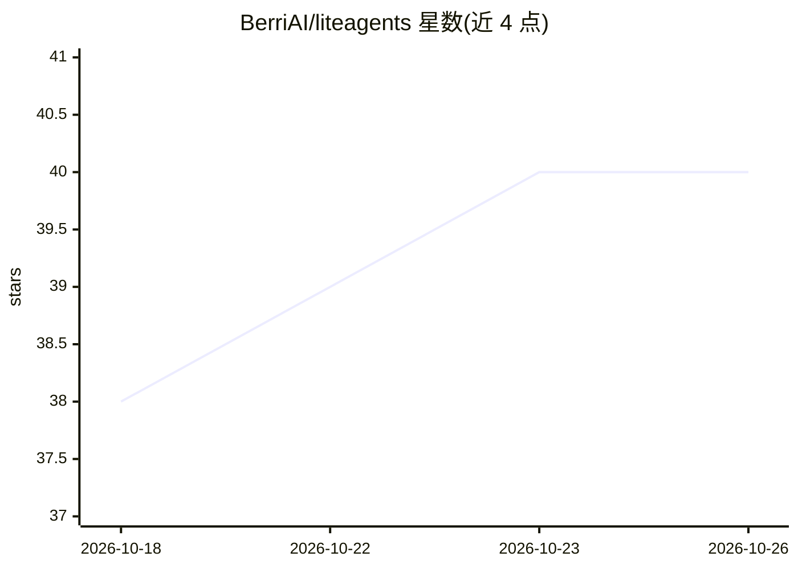

# BerriAI/liteagents

⭐ 40 · Python · MIT · 推送 2026-09-30 · [GitHub](https://github.com/BerriAI/liteagents) · [官网](https://www.litellm.ai/liteagents) · 组织维护

**跨 agent 框架的统一 Python SDK，一套代码切换六种 harness**

面向 Python 开发者的 agent SDK：提供与 Claude Agent SDK 相同的 query() 接口，通过 profile.harness 一行切换 DeepAgents、Pydantic AI、Claude Agent SDK、Codex、OpenCode 六种框架，模型侧经 LiteLLM 支持 OpenAI/Anthropic/Gemini/Ollama 等多家 provider。支持类型化自定义工具、MCP、流式对话、JSON/YAML 配置文件，以及可选的 Temporal 持久化执行与崩溃恢复。预览版通过 GitHub release wheel 安装，PyPI 名称当前归属其他包。

## 筛选速览

| 维度 | 判定 | 备注 |
|---|---|---|
| AI 角色 | `ai-ecosystem` | LLM/agent 周边工具 |
| 许可风险 | `permissive` | MIT |
| 部署形态 | `library` | 以包/库形式分发 |
| 模型依赖 | locked-api |  |
| 硬件要求 | — | 无带数字的原话,不猜 |
| 安装摩擦 | `low` | 无编译、无系统依赖或容器化 |
| 成熟度 | — | 结构信号不足 |

## 能力要点

- 一套应用代码切换六种 agent harness（改 profile.harness 即可）
- LiteLLM 统一模型 provider 配置，同一模型/密钥跨 harness 复用
- 类型化 Python 工具函数自动生成 schema 并适配各框架，支持 MCP
- 可选 Temporal 持久化执行、重放与审批等 run 管理

## 适用场景

- 在多个 agent 框架间对比同一任务的表现而不改代码
- 构建可切换底层框架的 agent 应用，避免供应商锁定
- 需要持久化恢复与审批流程的长时间 agent 运行

## 场景标签

`Agent 框架` `模型网关` · 领域:Agent 开发

## 证据(README 行号)

> L3: Switch between **DeepAgents, Pydantic AI, Claude Agent SDK, Codex, and OpenCode**
> L4: through one Python SDK. Pick a harness and model, run your agent, then change
> L87: `your app → LiteAgents → selected harness → LiteLLM → model provider`

## 星数曲线

2026-10-18 38 → 2026-10-26 40（+2）

---
*卡片 v1 · prompt 1.4 · 生成 2026-10-25 · 置信度 mid · 依据 README sha `c6ebab1a264b` · [字段定义](../../DATASET.md)*
