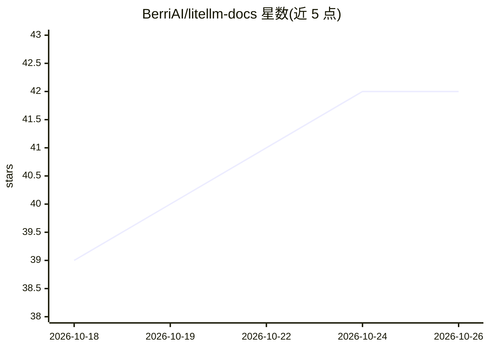

# BerriAI/litellm-docs

⭐ 42 · JavaScript · MIT · 推送 2026-10-25 · [GitHub](https://github.com/BerriAI/litellm-docs) · [官网](https://litellm.vercel.app) · 组织维护

**LiteLLM 官方文档站点的文档源码仓库**

LiteLLM 官方文档（docs.litellm.ai）的源码仓库，基于 Docusaurus 3 构建。README 仅覆盖文档站的本地开发、构建与部署流程：npm install / npm start 启动带实时重载的本地站点，npm run build 生成静态输出到 build 目录；构建时限制并发渲染页数与图片优化数量以适配 8 GB 的 Vercel 构建机，可通过 DOCUSAURUS_SSR_CONCURRENCY 覆盖；推送 main 分支后由 Vercel 自动部署。面向的是为 LiteLLM 文档贡献内容的开发者，不含 LiteLLM 本体的安装运行说明。

## 筛选速览

| 维度 | 判定 | 备注 |
|---|---|---|
| AI 角色 | `ai-ecosystem` | LLM/agent 周边工具 |
| 许可风险 | `permissive` | MIT |
| 部署形态 | `library` | 以包/库形式分发 |
| 模型依赖 | — | README 未给出锁定关系 |
| 硬件要求 | — | 无带数字的原话,不猜 |
| 安装摩擦 | `low` | 无编译、无系统依赖或容器化 |
| 成熟度 | — | 结构信号不足 |

## 能力要点

- docs.litellm.ai 文档站点的源码仓库
- 基于 Docusaurus 3，npm 启动本地开发含实时重载
- 构建并发可调（DOCUSAURUS_SSR_CONCURRENCY）以适配 8 GB 构建机

## 适用场景

- 为 LiteLLM 文档撰写或修改内容并本地预览
- 了解 LiteLLM 文档站的构建与部署流程

## 场景标签

 · 领域:LLM 基础设施/文档

## 证据(README 行号)

> L1: # litellm-docs
> L3: Source for docs.litellm.ai; the documentation site for LiteLLM.

## 星数曲线

2026-10-18 39 → 2026-10-26 42（+3）

---
*卡片 v1 · prompt 1.4 · 生成 2026-10-25 · 置信度 high · 依据 README sha `2c584c3f492f` · [字段定义](../../DATASET.md)*
