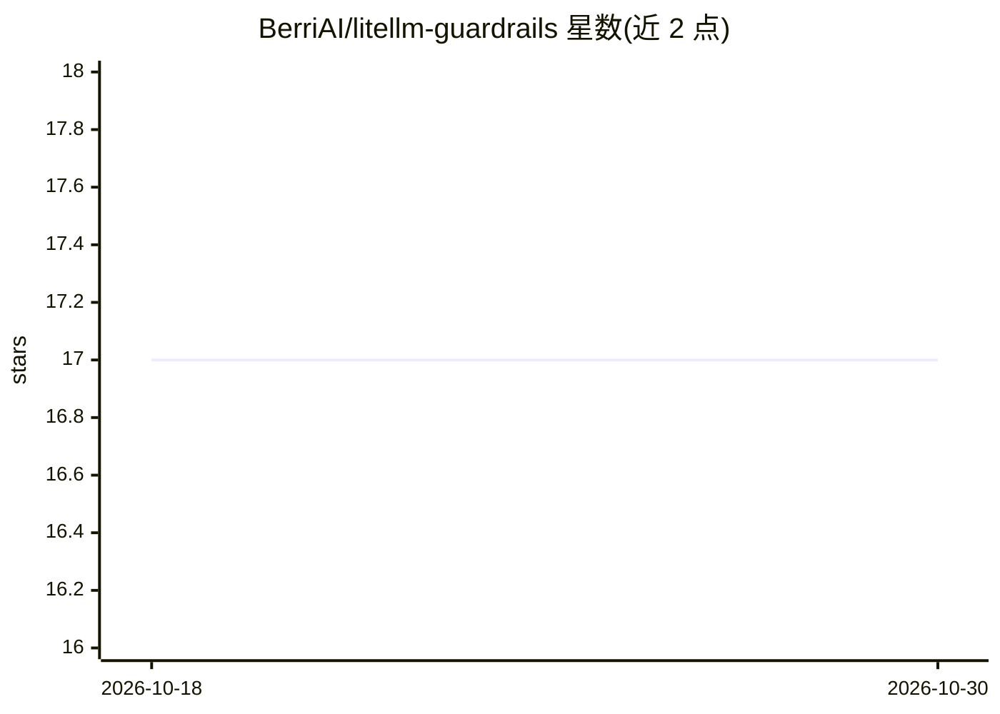

# BerriAI/litellm-guardrails

⭐ 17 · Svelte · 推送 2026-02-07 · [GitHub](https://github.com/BerriAI/litellm-guardrails) · 组织维护

**LiteLLM 代理服务器的社区自定义代码护栏注册表**

由 BerriAI 维护的 LiteLLM 代理服务器自定义代码护栏集合：收录在 LLM 请求前/后运行的 Python 函数，用于阻断有害内容、脱敏 PII、检测提示注入、校验 JSON schema、限流与格式化响应等，按安全/校验/审核/内容/限流等类别组织。使用方式为从 guardrails.json 复制代码并加入 LiteLLM 配置，护栏函数可调用 regex、JSON 校验、HTTP 等内置原语。配套网站部署于 Vercel，接受社区 PR 贡献，MIT 许可。

## 筛选速览

| 维度 | 判定 | 备注 |
|---|---|---|
| AI 角色 | `ai-ecosystem` | LLM/agent 周边工具 |
| 许可风险 | `none` | — |
| 部署形态 | `library` | 以包/库形式分发 |
| 模型依赖 | — | README 未给出锁定关系 |
| 硬件要求 | — | 无带数字的原话,不猜 |
| 安装摩擦 | `low` | 无编译、无系统依赖或容器化 |
| 成熟度 | — | 结构信号不足 |

## 能力要点

- 12 个现成护栏：PII 检测/脱敏、提示注入检测、API key 泄露防护、毒性过滤等
- 护栏以 pre-call / post-call Python 函数形式运行于 LiteLLM 代理
- 提供 regex、JSON schema 校验、URL 提取、沙箱化 HTTP 等内置原语
- 社区贡献流程：编辑 guardrails.json 并提交独立护栏文件

## 适用场景

- 为 LiteLLM 代理快速接入 PII 脱敏或提示注入拦截
- 按用户维度限流或校验 LLM 响应的 JSON schema
- 浏览社区护栏实现并参考编写自己的护栏

## 场景标签

`网络安全` · 领域:学习与行业

## 证据(README 行号)

> L3: A community collection of custom code guardrails for LiteLLM. Browse, copy, and deploy guardrails to protect your LL
> L9: Custom code guardrails are Python functions that run before (pre-call) or after (post-call) your LLM requests. They 

## 星数曲线

2026-10-18 17 → 2026-10-30 17（+0）

---
*卡片 v1 · prompt 1.4 · 生成 2026-10-30 · 置信度 mid · 依据 README sha `6807addb3d52` · [字段定义](../../DATASET.md)*
