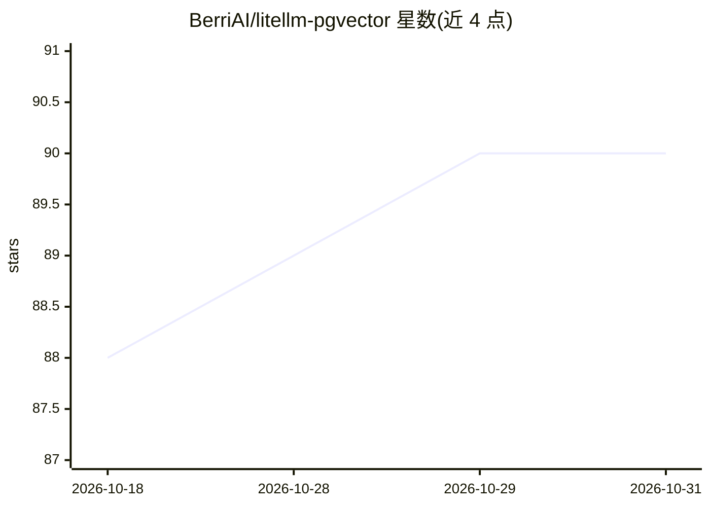

# BerriAI/litellm-pgvector

⭐ 90 · Python · MIT · 推送 2026-10-06 · [GitHub](https://github.com/BerriAI/litellm-pgvector) · 组织维护

**基于 PGVector 的 OpenAI 兼容向量存储 API 服务，供开发者自建向量库**

FastAPI 应用，提供 OpenAI Vector Stores 兼容的 HTTP 端点：创建/列出向量存储、单条与批量写入 embedding、相似度搜索。向量存储与检索由 PostgreSQL + PGVector 承担，embedding 生成通过 LiteLLM proxy 接入任意模型（OpenAI/Cohere/Voyage 等），数据库字段名可通过环境变量自定义。安装需 pip 依赖、Prisma 迁移和外部 LiteLLM proxy，也支持 Docker 构建。面向需要在自有 PostgreSQL 上获得 OpenAI 向量存储 API 的开发者。

## 筛选速览

| 维度 | 判定 | 备注 |
|---|---|---|
| AI 角色 | `ai-ecosystem` | LLM/agent 周边工具 |
| 许可风险 | `permissive` | MIT |
| 部署形态 | `self-host` | docker 或自建部署 |
| 模型依赖 | — | README 未给出锁定关系 |
| 硬件要求 | — | 无带数字的原话,不猜 |
| 安装摩擦 | `low` | 无编译、无系统依赖或容器化 |
| 成熟度 | — | 结构信号不足 |

## 能力要点

- OpenAI 兼容的 /v1/vector_stores 端点（创建/列表/写入/搜索）
- PGVector 存储与相似度搜索，embedding 字段默认 1536 维
- LiteLLM proxy 接入任意 embedding 模型（OpenAI/Cohere/Voyage）
- 数据库字段名可经环境变量自定义，支持存量数据批量迁移

## 适用场景

- 在自建 PostgreSQL 上获得 OpenAI Vector Stores 兼容 API
- 让依赖 OpenAI 向量存储接口的应用切换到自有基础设施
- 把已有数据库中的 embedding 数据批量迁移进向量存储

## 场景标签

`向量数据库` · 领域:知识与检索

## 证据(README 行号)

> L3: A FastAPI application that provides OpenAI-compatible vector store endpoints using PGVector and LiteLLM proxy for em
> L10: - 🔄 LiteLLM proxy integration for any embedding model

## 星数曲线

2026-10-18 88 → 2026-10-31 90（+2）

---
*卡片 v1 · prompt 1.4 · 生成 2026-10-23 · 置信度 high · 依据 README sha `54f31b68f039` · [字段定义](../../DATASET.md)*
