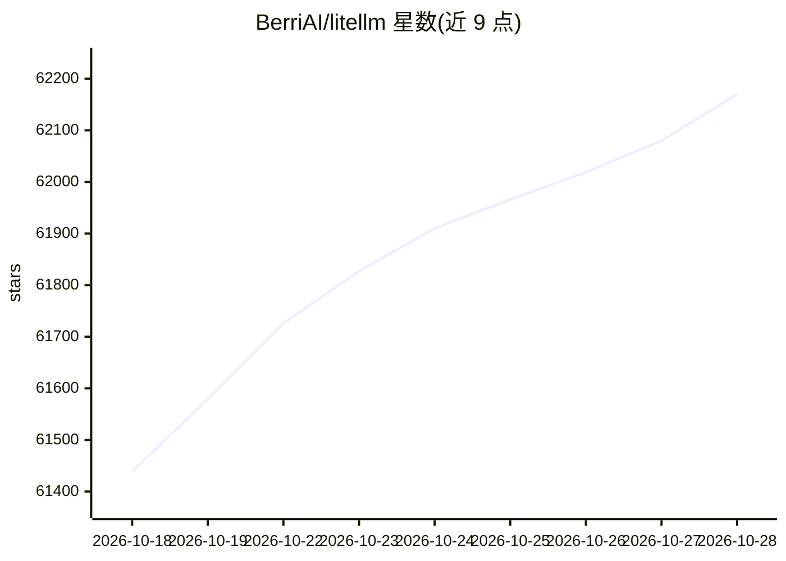

# BerriAI/litellm

⭐ 62,247 · Python · NOASSERTION · 推送 2026-10-28 · [GitHub](https://github.com/BerriAI/litellm) · [官网](https://docs.litellm.ai/docs/) · 组织维护

**统一的 LLM 网关：一份接口调用 100+ 模型供应商**

提供 Python SDK 与可自部署的 AI Gateway（Proxy Server）两种使用方式，用 OpenAI 格式统一调用 100+ LLM 供应商。支持 /chat/completions、/responses、/embeddings、/images、/audio、/batches、/rerank、/messages 等端点，以及 A2A 代理调用、MCP 服务器接入。网关侧提供虚拟密钥、花费跟踪、guardrails、负载均衡与管理后台；SDK 侧提供带重试/回退的 Router 与可观测性回调。核心为 Rust 实现，附 Python SDK。

## 筛选速览

| 维度 | 判定 | 备注 |
|---|---|---|
| AI 角色 | `ai-ecosystem` | LLM/agent 周边工具 |
| 许可风险 | `none` | NOASSERTION |
| 部署形态 | `self-host` | docker 或自建部署 |
| 模型依赖 | local-ok | 支持本地模型 |
| 硬件要求 | — | 无带数字的原话,不猜 |
| 安装摩擦 | `low` | 无编译、无系统依赖或容器化 |
| 成熟度 | — | 结构信号不足 |

## 动量与使用信号

- 维护:`active` — 距上次 push 0.6 天,年发版 100,373 位贡献者
- 涨星:近 1 天 **+70**(自 20261016 起算)
- 安装:pypi 包 `dist` 月下载 929
- 平台:— · 协议:OPENAI-API / MCP / OLLAMA

## 能力要点

- Python SDK 与 AI Gateway（Proxy Server）两种形态，OpenAI 格式调用 100+ 供应商
- A2A Agent 网关与 MCP 网关：将 MCP 服务器接入 /chat/completions
- 虚拟密钥、多租户花费跟踪、guardrails、负载均衡与管理后台
- Router 支持跨部署的重试/回退与应用级负载均衡

## 适用场景

- 为团队搭建集中式 LLM 网关，统一密钥与费用管理
- 在 Python 项目中用统一接口切换多个模型供应商
- 把 MCP 服务器和 A2A Agent 暴露为统一网关端点
- 在 Azure/OpenAI 等多部署间做重试与回退

## 场景标签

`模型网关` · 领域:Agent 开发

## 证据(README 行号)

> L40: LiteLLM is an open source AI Gateway that gives you a single, unified interface to call 100+ LLM providers — OpenAI
> L42: Use it as a **Python SDK** for direct library integration, or deploy the **AI Gateway (Proxy Server)** as a central
> L53: - **Production-ready gateway** — virtual keys, spend tracking, guardrails, load balancing, and an admin dashboard o

## 星数曲线

2026-10-18 61,439 → 2026-10-28 62,170（+731）

---
*卡片 v1 · prompt 1.4 · 生成 2026-10-18 · 置信度 high · 依据 README sha `f559f3c7c57f` · [字段定义](../../DATASET.md)*
