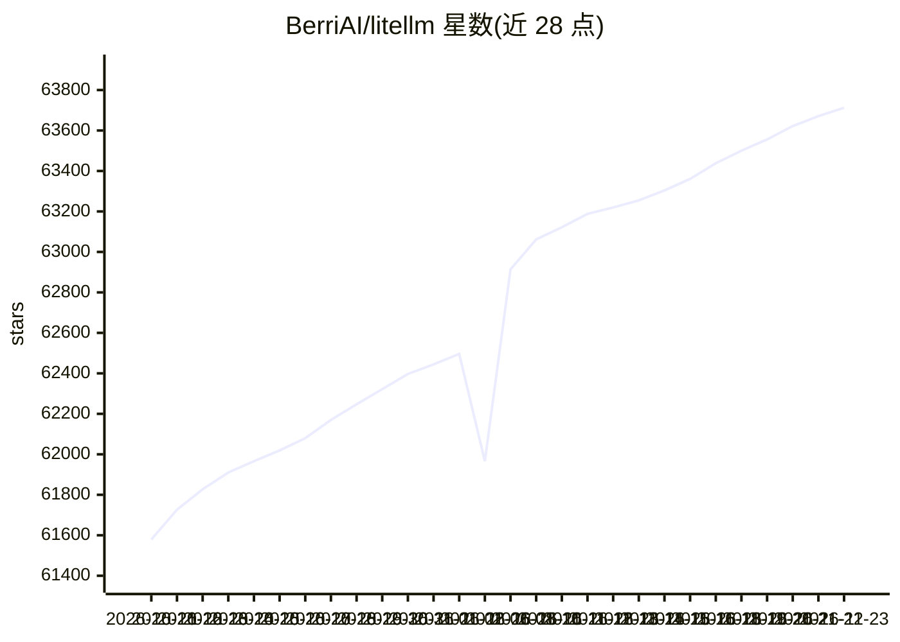

# BerriAI/litellm

⭐ 63,712 · Python · NOASSERTION · 推送 2026-11-22 · [GitHub](https://github.com/BerriAI/litellm) · [官网](https://docs.litellm.ai/docs/) · 组织维护

**给开发者提供统一接口调用 100+ LLM 的 AI 网关**

开源 AI Gateway：以 Python SDK 或自托管代理服务器两种形态，用统一的 OpenAI 格式接口调用 100+ LLM 提供商。功能覆盖虚拟密钥、费用追踪、guardrails、负载均衡、管理面板，支持 /chat/completions、/embeddings、/images、/audio、/rerank 等端点，并提供 Auto Router 自动选模型、A2A Agent 接入、MCP 网关与 agent harness（Claude Code/Codex 等）运行能力。README 还给出 agent 评测接口（agent_eval）与按任务对比 harness/模型的机制。

## 筛选速览

| 维度 | 判定 | 备注 |
|---|---|---|
| AI 角色 | `ai-ecosystem` | LLM/agent 周边工具 |
| 许可风险 | `none` | NOASSERTION |
| 部署形态 | `self-host` | docker 或自建部署 |
| 模型依赖 | local-ok | 支持本地模型 |
| 硬件要求 | — | 无带数字的原话,不猜 |
| 安装摩擦 | `low` | 无编译、无系统依赖或容器化 |
| 成熟度 | — | 结构信号不足 |

## 动量与使用信号

- 维护:`active` — 距上次 push 0.6 天,年发版 100,373 位贡献者
- 涨星:近 1 天 **+70**(自 20261016 起算)
- 安装:pypi 包 `dist` 月下载 929
- 平台:— · 协议:OPENAI-API / MCP / OLLAMA

## 能力要点

- 统一 OpenAI 格式接口调用 100+ 提供商，提供 Python SDK 与代理服务器两种形态
- 代理服务器提供虚拟密钥、费用追踪、guardrails、负载均衡与管理面板
- 支持 Auto Router 自动路由、A2A 协议与 MCP 网关
- agent harness 支持 Claude Code/Codex/OpenCode 等接入任意模型

## 适用场景

- 团队内部集中管理多家 LLM 的调用、密钥与费用
- 在不改代码的情况下切换或混用多个 LLM 提供商
- 通过网关给 agent 工具（如 IDE、CLI agent）统一供模型
- 将多个 MCP 服务器接入统一网关供 LLM 调用

## 场景标签

`模型网关` · 领域:Agent 开发

## 证据(README 行号)

> L40: LiteLLM is an open source AI Gateway that gives you a single, unified interface to call 100+ LLM providers — OpenAI
> L42: Use it as a **Python SDK** for direct library integration, or deploy the **AI Gateway (Proxy Server)** as a central
> L53: - **Production-ready gateway** — virtual keys, spend tracking, guardrails, load balancing, and an admin dashboard o

## 星数曲线

2026-10-21 61,579 → 2026-11-23 63,712（+2,133）

---
*卡片 v1 · prompt 1.4 · 生成 2026-11-22 · 置信度 high · 依据 README sha `36e4bfdc1619` · [字段定义](../../DATASET.md)*
