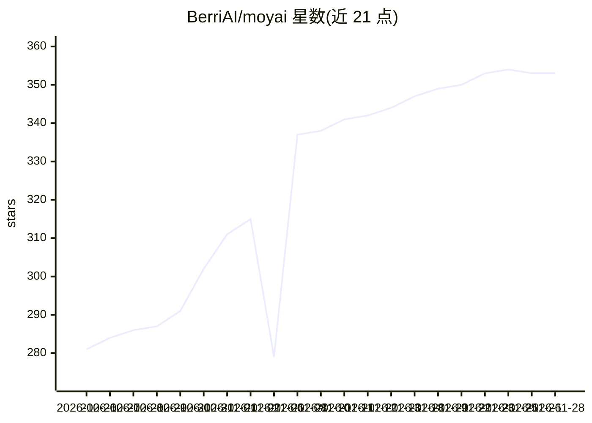

# BerriAI/moyai

⭐ 353 · Python · MIT · 推送 2026-11-27 · [GitHub](https://github.com/BerriAI/moyai) · 组织维护

**自托管编码 Agent 工作区，支持后台任务与多模型接入**

Moyai 提供一个共享的 AI 工作区，用户可对话驱动 Agent 执行编码与连接服务任务，查看其计算机操作过程并保留文件与会话历史。架构上以 Pydantic AI 与 Harness 作为 Agent 框架，Temporal 负责持久化执行，Modal 或 AWS Lambda MicroVM 提供执行环境，LiteLLM 供应模型。本地试用由 Docker 快速启动并自动管理 SQLite、加密存储与本地 Temporal；团队部署需自备 PostgreSQL、S3 兼容存储与 HTTPS 来源；模型与计算资源用量由相应服务商计费。

## 筛选速览

| 维度 | 判定 | 备注 |
|---|---|---|
| AI 角色 | `ai-ecosystem` | LLM/agent 周边工具 |
| 许可风险 | `permissive` | MIT |
| 部署形态 | `self-host` | docker 或自建部署 |
| 模型依赖 | — | README 未给出锁定关系 |
| 硬件要求 | — | 无带数字的原话,不猜 |
| 安装摩擦 | `low` | 无编译、无系统依赖或容器化 |
| 成熟度 | — | 结构信号不足 |

## 能力要点

- Agent 在 Modal 计算机/AWS Lambda MicroVM 中执行，Temporal 做持久化执行
- Docker 快速启动自动管理 SQLite、加密文件存储与本地 Temporal 开发服务器
- LiteLLM 作为模型网关，可配置 Responses-capable 模型
- 提供 standalone/split 拓扑与 bundled/external Temporal 部署选项

## 适用场景

- 本地用 Docker 试运行一个可执行文件任务的编码 Agent
- 为团队部署带持久化存储与会话历史的自托管 Agent 工作区
- 通过 Slack/MR 工作流将 Agent 接入代码评审流程

## 场景标签

`编码 Agent` `代码审查` · 领域:编码与开发

## 证据(README 行号)

> L3: Moyai is a shared AI workspace for coding and connected-service tasks. Chat with
> L5: resulting files and history. Pydantic AI and Harness provide the agent; Temporal
> L6: runs durable execution, Modal or AWS Lambda MicroVMs provide its computer, and LiteLLM supplies models.

## 星数曲线

2026-10-26 281 → 2026-11-28 353（+72）

---
*卡片 v1 · prompt 1.4 · 生成 2026-11-25 · 置信度 mid · 依据 README sha `40f2f4b51e22` · [字段定义](../../DATASET.md)*
