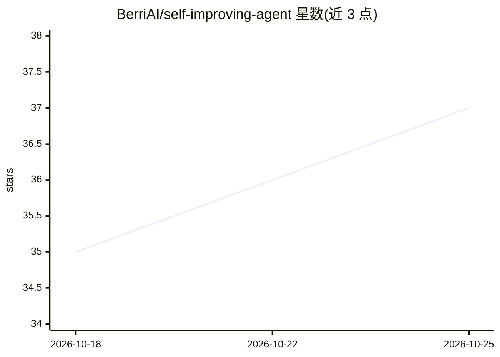

# BerriAI/self-improving-agent

⭐ 37 · TypeScript · MIT · 推送 2026-05-05 · [GitHub](https://github.com/BerriAI/self-improving-agent) · 组织维护

**给 AI agent 加自改进循环的工具库：提案 diff、人批准、开草稿 PR**

npm 安装的 TypeScript 库，向任意 AI 编码 agent 追加两个工具：writeImprovementProposal 与 applyProposal。agent 针对可重复的失败模式提出最小 diff，用户在最近消息中明确批准后，库自动 clone 目标仓库、经 GitHub REST API 推送分支并创建草稿 PR。提供 Claude Agent SDK 与 pi-agent-core 专属子路径，也可配合 OpenAI SDK、Vercel AI SDK、LangChain 等任何接受 JSON Schema 工具的框架。内置四层安全机制：工具描述规则、userConfirmedInThisMessage 校验、onBeforeApply 钩子、细粒度 PAT 权限限制。要求 Node≥18 与 PATH 上的 git。

## 筛选速览

| 维度 | 判定 | 备注 |
|---|---|---|
| AI 角色 | `ai-ecosystem` | LLM/agent 周边工具 |
| 许可风险 | `permissive` | MIT |
| 部署形态 | `library` | 以包/库形式分发 |
| 模型依赖 | locked-api |  |
| 硬件要求 | — | 无带数字的原话,不猜 |
| 安装摩擦 | `low` | 无编译、无系统依赖或容器化 |
| 成熟度 | — | 结构信号不足 |

## 能力要点

- 两个工具即可为任意 agent 接入自改进循环，不改动系统提示词
- 支持 Claude Agent SDK / pi-agent-core 专属子路径及通用 JSON Schema 工具接口
- 四层安全机制（工具描述、Schema 校验、onBeforeApply 钩子、PAT 权限范围）
- 无需本地 clone 或 gh CLI，通过 GitHub REST API 推送并开草稿 PR

## 适用场景

- 让 Cursor / Claude Code 等编码 agent 根据用户反馈自动修复自身提示词或配置
- 在 Slack 反馈到 GitHub PR 之间建立带人工批准的自动化链路
- 为自研 agent 框架追加最小侵入的自改进能力

## 场景标签

`Agent 框架` `编码 Agent` · 领域:Agent 开发

## 证据(README 行号)

> L21:  - anything else → import from `self-improving-agent` (root)
> L85: const fb = feedbackTools(); // returns { writeImprovementProposal, applyProposal }

## 星数曲线

2026-10-18 35 → 2026-10-25 37（+2）

---
*卡片 v1 · prompt 1.4 · 生成 2026-10-25 · 置信度 high · 依据 README sha `82c7e130fe95` · [字段定义](../../DATASET.md)*
