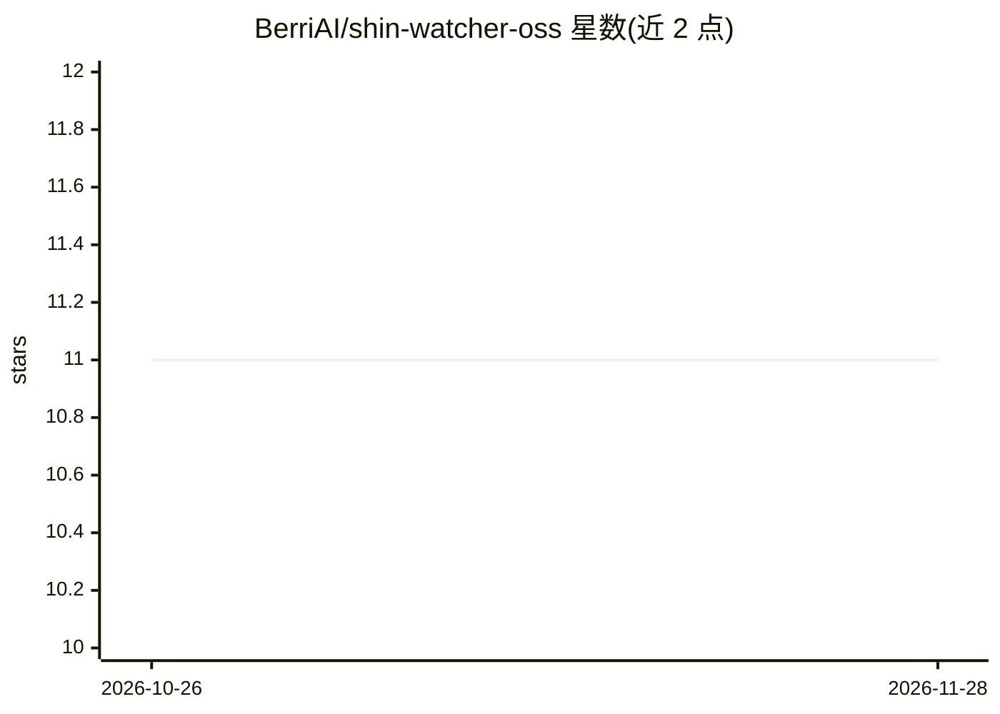

# BerriAI/shin-watcher-oss

⭐ 11 · TypeScript · 推送 2026-11-26 · [GitHub](https://github.com/BerriAI/shin-watcher-oss) · 组织维护

**自动复现并评审 LiteLLM GitHub issue 的 agent**

面向 LiteLLM 仓库的自动化 agent：自动选取开放 issue，通过浏览器和 curl 对运行中的 LiteLLM proxy 复现问题，生成带 0–5 判定分数、难度分类和前后截图的报告。支持 POST_COMMENTS 将报告发为 issue 评论；AUTO_FIX=true 时对简单/中等难度 issue 尝试修复并提交 draft PR。默认两个安全开关为 false，首次运行仅在本地产出结果供人工审核。

## 筛选速览

| 维度 | 判定 | 备注 |
|---|---|---|
| AI 角色 | `ai-native` | 本体是模型或模型工具 |
| 许可风险 | `none` | — |
| 部署形态 | `library` | 以包/库形式分发 |
| 模型依赖 | — | README 未给出锁定关系 |
| 硬件要求 | — | 无带数字的原话,不猜 |
| 安装摩擦 | `low` | 无编译、无系统依赖或容器化 |
| 成熟度 | — | 结构信号不足 |

## 能力要点

- 自动选取开放 issue 并复现（浏览器 + curl 对 live proxy）
- 0–5 判定分数与难度分类的复现报告
- AUTO_FIX 开启后生成修复草稿 PR
- 安全开关默认关闭，先本地审查再写回 GitHub

## 适用场景

- 让 agent 自动分诊 LiteLLM 仓库的 bug report
- 在人工审核后再发布 issue 评论与修复 PR
- 为维护者生成带截图的复现报告

## 场景标签

`代码审查` `浏览器自动化` · 领域:效率与自动化

## 证据(README 行号)

> L5: an agent that picks open LiteLLM GitHub issues, tries to reproduce them, and writes a report with a verdict score an
> L7: when `AUTO_FIX=true`, easy/medium issues also get a fix attempt and a draft PR.

## 星数曲线

2026-10-26 11 → 2026-11-28 11（+0）

---
*卡片 v1 · prompt 1.4 · 生成 2026-11-19 · 置信度 high · 依据 README sha `923e8b8fdea3` · [字段定义](../../DATASET.md)*
