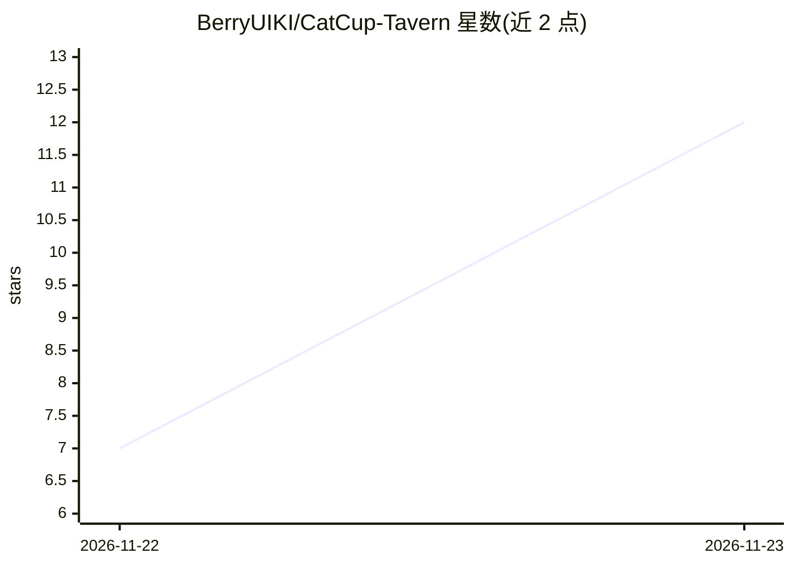

# BerryUIKI/CatCup-Tavern

⭐ 12 · TypeScript · AGPL-3.0 · 推送 2026-11-22 · [GitHub](https://github.com/BerryUIKI/CatCup-Tavern) · [官网](https://berryuiki.github.io/CatCup-Tavern/) · 个人维护

**面向 SillyTavern 用户的 AI 角色扮演 Web/桌面客户端**

local-first 的 AI 角色扮演客户端，提供 Windows 安装包、浏览器与 LAN 三种形态，共用同一个 Fastify 服务端；服务端负责提示词组装、token 预算、world info 扫描与 provider 调用，客户端渲染 SSE 流。直接读写 SillyTavern 的角色卡（PNG/JSON V2/V3、CharX）、聊天 JSONL、world info 与 OpenAI presets 格式，无需导出即可双向迁移。支持群聊、滚动记忆摘要、语音朗读与图像生成接入。无内置 TLS；无 macOS/Linux 发布版；不支持 STscript、扩展与图片输入。

## 筛选速览

| 维度 | 判定 | 备注 |
|---|---|---|
| AI 角色 | `ai-native` | 本体是模型或模型工具 |
| 许可风险 | `viral` | AGPL-3.0 |
| 部署形态 | `desktop` | 安装包/桌面程序 |
| 模型依赖 | local-ok | 支持本地模型 |
| 硬件要求 | — | 无带数字的原话,不猜 |
| 安装摩擦 | `low` | 无编译、无系统依赖或容器化 |
| 成熟度 | `idea` | |

## 能力要点

- 读写 SillyTavern 原生格式的角色卡、聊天、世界书与预设，免导出迁移
- 同一 Fastify 服务端支撑 Web/LAN/桌面（Tauri，自带运行时）三种形态
- 服务端持有生成管线，含 context inspector 展示提示词组装与条目触发原因
- 支持群聊、滚动摘要记忆、语音与图像生成（Automatic1111/ComfyUI/OpenAI 兼容端点）

## 适用场景

- 沿用现有 SillyTavern 角色卡与世界书在新客户端继续角色扮演
- 在局域网多设备访问同一个自托管角色扮演实例
- 需要查看提示词组装与 world info 触发细节的调参场景

## 场景标签

`聊天机器人` · 领域:对话与助手

## 证据(README 行号)

> L8: A **local-first AI roleplay client** with a modern interface, a server-owned generation pipeline and a desktop build
> L79: **Providers.** OpenAI-compatible (including local servers), OpenRouter, Anthropic and Ollama. API keys live in `dat
> L87: - **Compatibility is a hard constraint.** Field names, JSONL headers and preset semantics follow SillyTavern, and a

## 星数曲线

2026-11-22 7 → 2026-11-23 12（+5）

---
*卡片 v1 · prompt 1.4 · 生成 2026-11-22 · 置信度 mid · 依据 README sha `c877f44adccd` · [字段定义](../../DATASET.md)*
