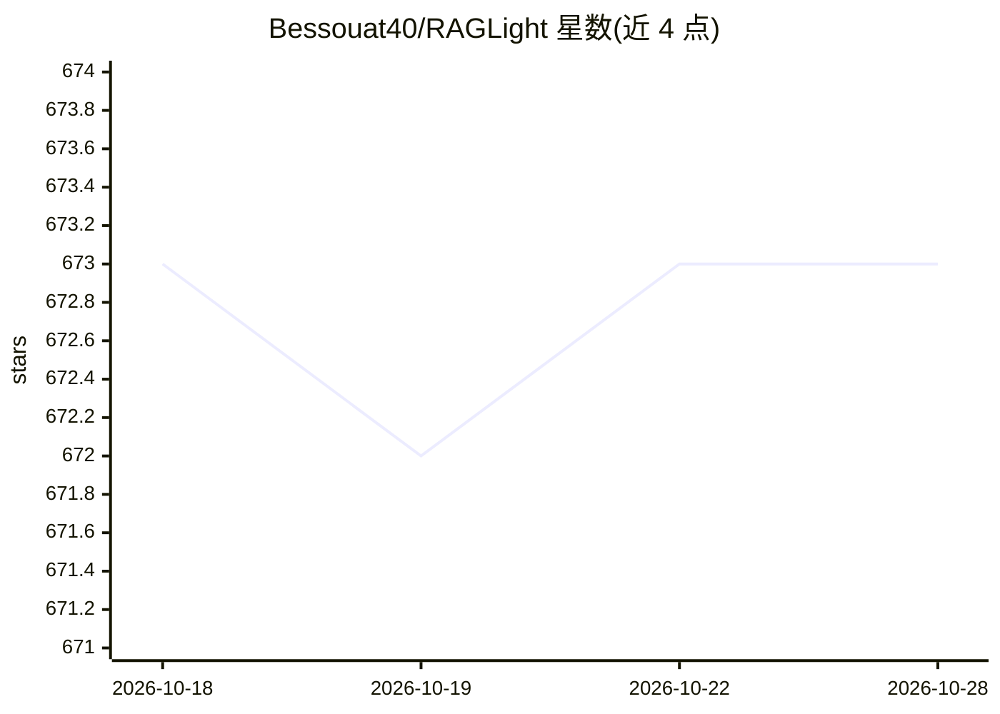

# Bessouat40/RAGLight

⭐ 673 · Python · MIT · 推送 2026-10-16 · [GitHub](https://github.com/Bessouat40/RAGLight) · [官网](https://raglight.mintlify.app/) · 个人维护

**组合经典与 Agentic RAG 管线的类型化 Python 工具包**

面向开发者的 RAG 框架：通过结构化协议注入 LLM、嵌入模型与向量库，核心包无第三方运行时依赖。提供确定性 RAGPipeline 与独立命名空间的 AgenticPipeline（JSON 决策规划器、FunctionTool、MCP 可选适配器），支持目录递归摄取、查询改写、无状态管线与会话隔离、Langfuse 追踪。内置 OpenAI/Ollama/Gemini/Bedrock/Mistral/LMStudio/HuggingFace/Chroma/Qdrant 等集成，各自持有可选 SDK 依赖。v4 为破坏性版本，移除了 v3 的 API 服务器、CLI 与 UI。MIT 许可。

## 筛选速览

| 维度 | 判定 | 备注 |
|---|---|---|
| AI 角色 | `ai-ecosystem` | LLM/agent 周边工具 |
| 许可风险 | `permissive` | MIT |
| 部署形态 | `library` | 以包/库形式分发 |
| 模型依赖 | local-ok | 支持本地模型 |
| 硬件要求 | — | 无带数字的原话,不猜 |
| 安装摩擦 | `medium` | 含编译或系统依赖之一 |
| 成熟度 | — | 结构信号不足 |

## 能力要点

- 核心包零第三方运行时依赖，组件通过结构化协议注入
- 经典 RAG 与 Agentic RAG（MCP 可选、Agent 可替换）分层 API
- 内置 10+ 提供方集成（LLM/嵌入/向量库/文档处理/追踪）
- 注册表支持 JSON/TOML 序列化配置

## 适用场景

- 组装可插拔多提供方的 RAG 问答管线
- 构建带工具调用与 MCP 集成的 Agentic RAG 应用
- 对本地目录做递归摄取并向量化检索

## 场景标签

`RAG` `Agent 框架` · 领域:Agent 开发

## 证据(README 行号)

> L3: RAGLight 4 is a small, typed Python toolkit for composing classic and agentic
> L5: runtime dependency: applications inject an LLM, an embedding model, a vector
> L22: Available extras are `openai`, `ollama`, `mistral`, `gemini`, `bedrock`,

## 星数曲线

2026-10-18 673 → 2026-10-28 673（+0）

---
*卡片 v1 · prompt 1.4 · 生成 2026-10-21 · 置信度 high · 依据 README sha `646c54adbca2` · [字段定义](../../DATASET.md)*
