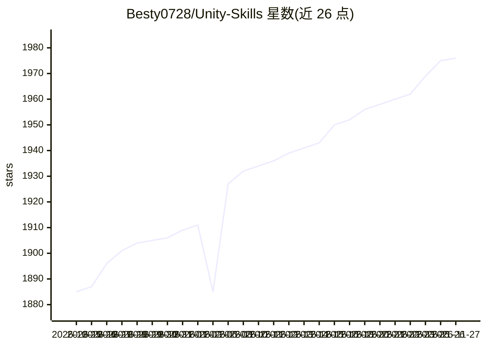

# Besty0728/Unity-Skills

⭐ 1,976 · C# · MIT · 推送 2026-11-26 · [GitHub](https://github.com/Besty0728/Unity-Skills) · [官网](https://www.micostar.cc) · 个人维护 · 中文 README

**让 AI 编码助手通过 REST 技能直接操作 Unity 编辑器**

以 REST API 形式向 AI 编码工具开放 Unity 编辑器操作能力的技能引擎：提供 873 个技能（57 个源文件、55 个类别）及 30 个按需加载的设计咨询模块，AI 可借此读写场景、预制体与 .meta 文件。治理层面提供 Approval/Auto/Bypass 三级权限模式、dryRun/plan 预执行校验、JSONL 审计日志、五类持久快照与按任务回滚、批量事务（失败回滚）。通过 Unity Package Manager 以 Git URL 安装，支持六个 IDE 的一键技能配置，维护基线为 Unity 2022.3+。基于 unity-mcp 概念深度重构。

## 筛选速览

| 维度 | 判定 | 备注 |
|---|---|---|
| AI 角色 | `ai-ecosystem` | LLM/agent 周边工具 |
| 许可风险 | `permissive` | MIT |
| 部署形态 | `desktop` | 安装包/桌面程序 |
| 模型依赖 | — | README 未给出锁定关系 |
| 硬件要求 | — | 无带数字的原话,不猜 |
| 安装摩擦 | `low` | 无编译、无系统依赖或容器化 |
| 成熟度 | — | 结构信号不足 |

## 能力要点

- 873 个 REST 技能覆盖 55 类编辑器操作，支持批量事务与失败自动回滚
- 三级权限模式（Approval/Auto/Bypass）与 JSONL 审计日志、五类持久快照
- dryRun/plan 预执行校验返回参数验证与影响估计，不写入任何内容
- 6 个 AI IDE（Claude Code/Codex/Cursor 等）一键安装技能，更新自动同步

## 适用场景

- 让 Claude Code/Cursor 等 AI 工具直接操作 Unity 场景与资源
- 需要细粒度权限与审计的团队协作中授权 AI 编辑工程
- AI 批量执行编辑器操作时要求事务性与可回滚
- 在 Domain Reload 后保持长连接与自动恢复的自动化流程

## 场景标签

`编码 Agent` · 领域:编码与开发

## 证据(README 行号)

> L10:  REST API-based AI-driven Unity Editor Automation Engine
> L57: - 🛠️ **873 REST Skills Toolkit**: 57 source files across 55 categories, plus 30 advisory design modules, with Batch
> L110: |**Claude Code**|✅ Supported|Intelligent Skill intent recognition, supports complex multi-step automation|

## 星数曲线

2026-10-25 1,885 → 2026-11-27 1,976（+91）

---
*卡片 v1 · prompt 1.4 · 生成 2026-11-27 · 置信度 high · 依据 README sha `013fed3c10d7` · [字段定义](../../DATASET.md)*
